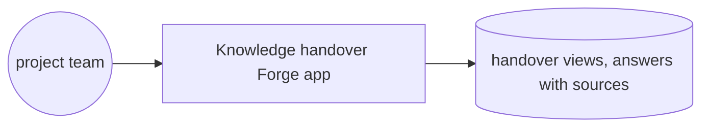
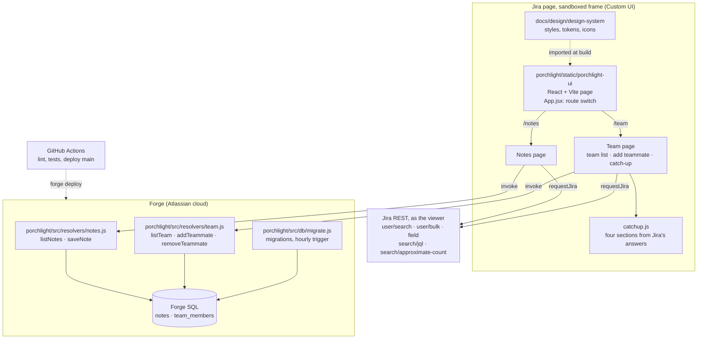

# Codegeist 2026 · architecture

**Status:** Active · **Updated:** 2026-11-07 by /build catch-up-view

## Context

## Components

| Component | Folder | What it does |
| --------- | ------ | ------------ |
| Page | `porchlight/static/porchlight-ui/` | The Porchlight page in Jira. `main.jsx` renders `App.jsx`, which reads the route with `view.createHistory()` and shows Team or Notes, the two subpages in Jira's sidebar |
| Team page | `porchlight/static/porchlight-ui/src/` (`TeamPage.jsx`, `TeamList.jsx`, `AddTeammate.jsx`, `CatchUp.jsx`) | The team list, the Jira user search to add a teammate, and one teammate's catch-up |
| Notes page | `porchlight/static/porchlight-ui/src/NotesPage.jsx` | Write a note, see every note with its author's name |
| Catch-up rules | `porchlight/static/porchlight-ui/src/catchup.js` | Plain functions that turn Jira's answers into open work, latest changes, blockers and next steps |
| Jira reads | `porchlight/static/porchlight-ui/src/api.js` | Calls Jira REST with `requestJira`, as the viewer: user search, names, the Flagged field, `search/jql` and `search/approximate-count` |
| Resolvers | `porchlight/src/resolvers/` | The only backend entry points. Notes: `listNotes`, `saveNote`. Team: `listTeam`, `addTeammate`, `removeTeammate`. The author or adder comes from Forge's context |
| Database | `porchlight/src/db/` | The `notes` and `team_members` tables in Forge SQL, their reversible migrations, and the queries |
| Shared rules | `porchlight/src/lib/` | The note length rule, used by both the page and the resolvers |
| Design system | `docs/design/design-system/` | The one set of tokens, styles and icons the page imports |
| E2E | `porchlight/e2e/` | The Playwright login, and two tests that walk the real Notes and Team pages on the dev site |
| CI | `.github/workflows/ci.yml` | Lint and tests on every push; deploy `main` to development |
