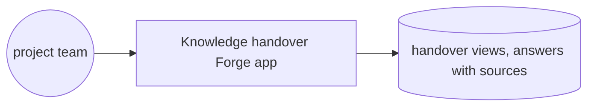
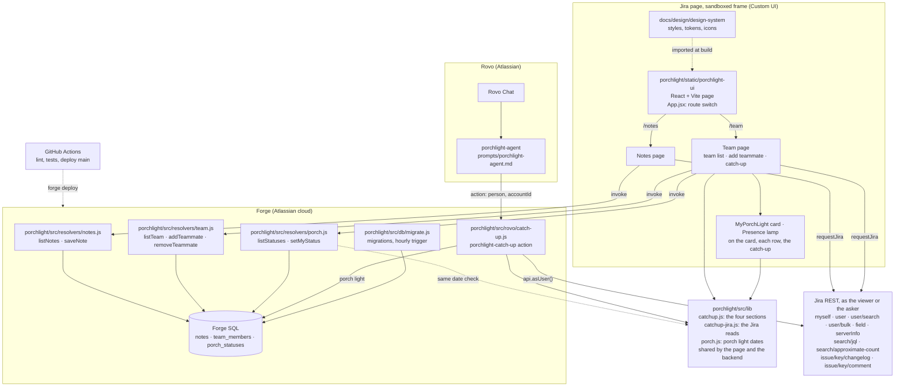
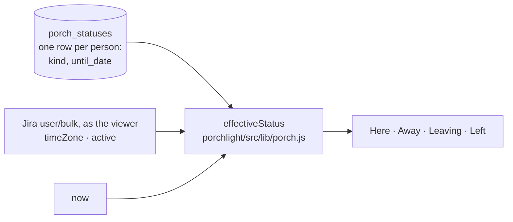

# Codegeist 2026 · architecture

**Status:** Active · **Updated:** 2026-11-08 by /ship ask-the-trail

## Context

## Components

| Component | Folder | What it does |
| --------- | ------ | ------------ |
| Page | `porchlight/static/porchlight-ui/` | The Porchlight page in Jira. `main.jsx` renders `App.jsx`, which reads the route with `view.createHistory()` and shows Team or Notes, the two subpages in Jira's sidebar |
| Team page | `porchlight/static/porchlight-ui/src/` (`TeamPage.jsx`, `TeamList.jsx`, `AddTeammate.jsx`, `CatchUp.jsx`) | The team list, the Jira user search to add a teammate, and one teammate's catch-up |
| Porch light | `porchlight/static/porchlight-ui/src/` (`MyPorchLight.jsx`, `Presence.jsx`) | `MyPorchLight` is the "Your porch light" card at the top of the Team column, with the form to set your own status. `Presence` is the lamp and its text on the card, on each team row and in the catch-up header |
| Notes page | `porchlight/static/porchlight-ui/src/NotesPage.jsx` | Write a note, see every note with its author's name |
| Catch-up rules | `porchlight/src/lib/catchup.js` | Plain functions that turn Jira's answers into open work, latest changes, blockers and next steps. The page and the Rovo action both use them (D32) |
| Jira reads | `porchlight/src/lib/catchup-jira.js`, with `porchlight/static/porchlight-ui/src/api.js` | The catch-up's Jira reads, written once with the transport passed in: user search, the Flagged field, `search/jql` and `search/approximate-count`, plus `issue/{key}/changelog` and `issue/{key}/comment` to top up a ticket whose history or comments the search clipped. `loadCatchUp` runs them all. The page passes `requestJira` (as the viewer) through `api.js`, which also reads names with each person's time zone and `active` flag |
| Rovo agent | `porchlight/manifest.yml` (`rovo:agent`, `action`), `porchlight/prompts/porchlight-agent.md`, `porchlight/src/rovo/catch-up.js` | The Porchlight agent in Rovo Chat. Its one action, `porchlight-catch-up`, finds the person, reads their catch-up from Jira with `api.asUser()` as the person chatting (D31), adds their porch light, and returns JSON with every ticket's link. The prompt tells the model how to write it. Runs only on a site with Rovo (D30) |
| Resolvers | `porchlight/src/resolvers/` | The page's backend entry points. Notes: `listNotes`, `saveNote`. Team: `listTeam`, `addTeammate`, `removeTeammate`. Porch light: `listStatuses`, `setMyStatus`. The author, adder or status owner comes from Forge's context |
| Database | `porchlight/src/db/` | The `notes`, `team_members` and `porch_statuses` tables in Forge SQL, their reversible migrations, and the queries |
| Shared rules | `porchlight/src/lib/` | Code that the page and the backend both run. `validate.js` has the note length rule. `porch.js` has the porch light date rules and works out what each lamp shows. `catchup.js` and `catchup-jira.js` are above |
| Design system | `docs/design/design-system/` | The one set of tokens, styles and icons the page imports |
| E2E | `porchlight/e2e/` | The Playwright login, which keeps one saved login per site, and four tests: Notes, Team and the porch light on dzaffren, and the Rovo agent on the demo site one-atlas-jddo |
| CI | `.github/workflows/ci.yml` | Lint and tests on every push; deploy `main` to development |

## Porch light

Porchlight stores only what a person chose: Away until a date, or Leaving on a date. Here has no row. The page works out Here after Away, and Left, each time it reads the statuses (D26). It uses the stored date, the person's Jira time zone and Jira's `active` flag. Porchlight never stores the time zone or the `active` flag (D27).

| Table | Key | Columns | Written by |
| ----- | --- | ------- | ---------- |
| `porch_statuses` | `account_id`, from Forge's context | `kind` (away or leaving), `until_date`, `set_at` | `setMyStatus`, only for the signed-in person. Here deletes the row |
