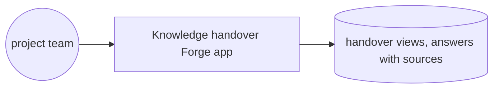
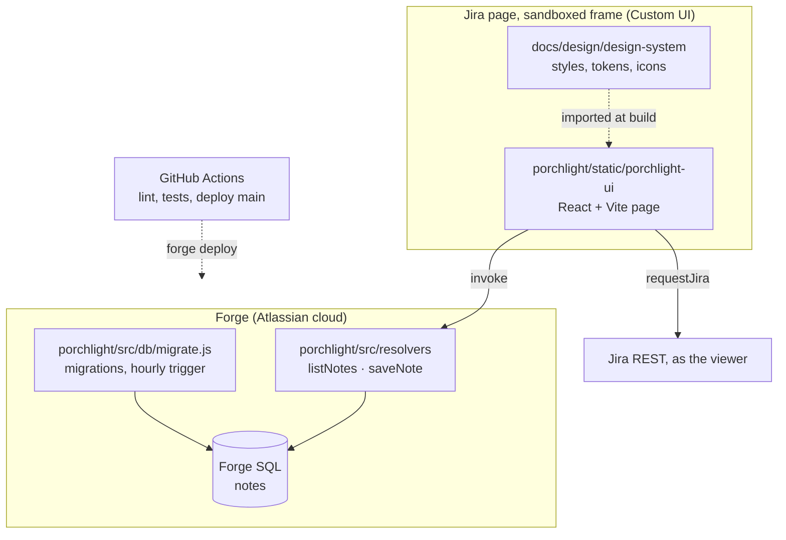

# Codegeist 2026 · architecture

**Status:** Active · **Updated:** 2026-11-07 by /ship skeleton

## Context

## Components

| Component | Folder | What it does |
| --------- | ------ | ------------ |
| Page | `porchlight/static/porchlight-ui/` | The Porchlight page in Jira: write a note, see every note with its author's name |
| Resolvers | `porchlight/src/resolvers/` | The only backend entry points; take the author from Forge's context and check the note |
| Database | `porchlight/src/db/` | The `notes` table in Forge SQL, its reversible migration, and the queries |
| Shared rules | `porchlight/src/lib/` | The note length rule, used by both the page and the resolvers |
| Design system | `docs/design/design-system/` | The one set of tokens, styles and icons the page imports |
| E2E | `porchlight/e2e/` | The Playwright login and the test that walks the real page on the dev site |
| CI | `.github/workflows/ci.yml` | Lint and tests on every push; deploy `main` to development |
