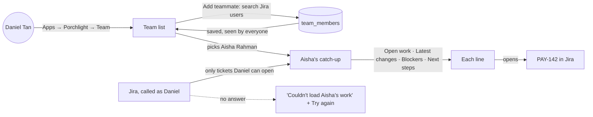
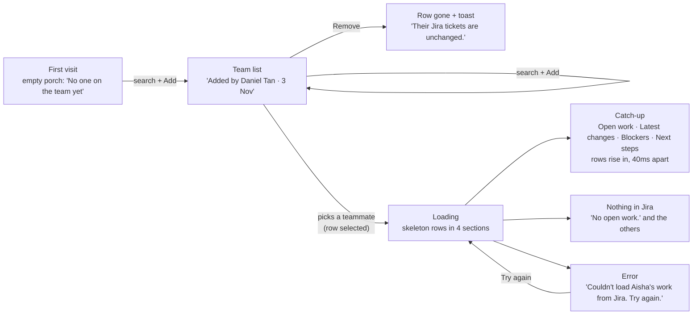
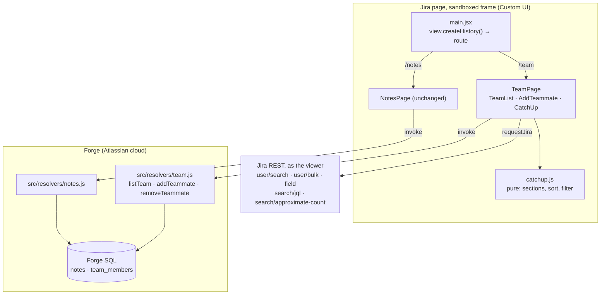
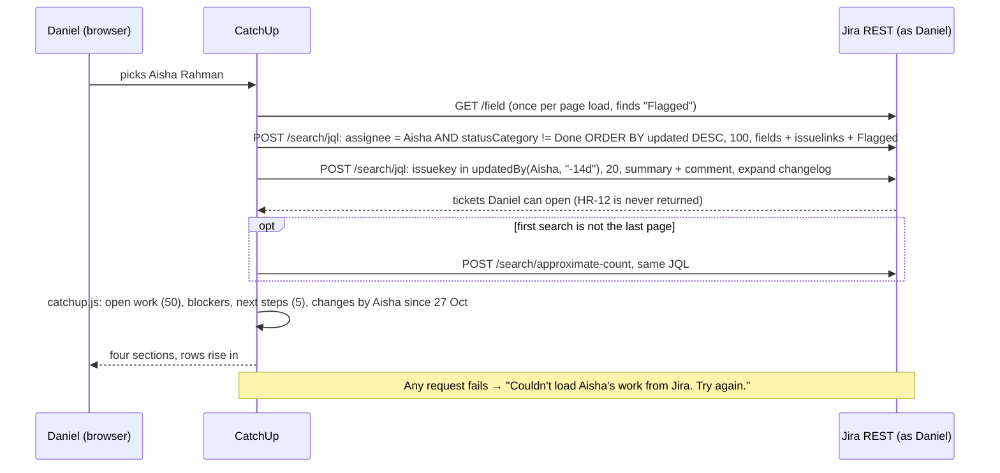
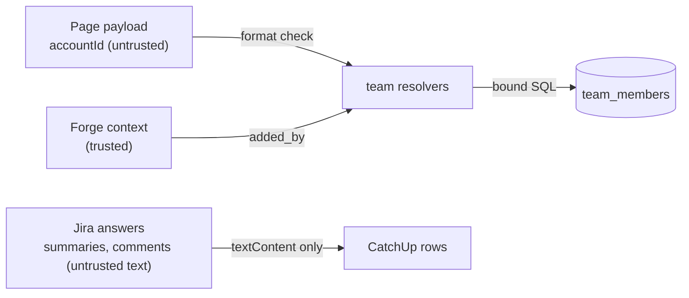
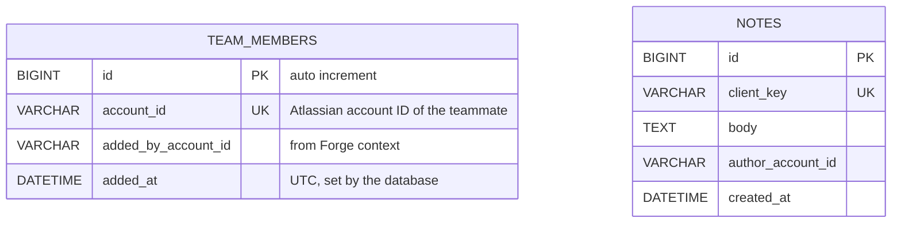

# Catch-up view

**Version:** v1 · **Status:** Shipped · **Type:** Feature · **Project type:** Web UI

**Shape doc:** docs/specs/knowledge-handover/shape.md
**Depends on:** skeleton

Porchlight gets a team list and a catch-up panel: pick a teammate and see their open work, what they did in the last 14 days, what blocks them and what comes next, read from Jira as the viewer. It is video moment 1 (leave), and it is the smallest slice that helps a team without any AI.

## Problem

When a teammate goes on leave, the person who covers for them spends at least half a day finding out what they were doing, and still messages them on holiday. That happens about once a month on the user's team. The facts are already in Jira, but they are spread over several projects, and Jira has no single view of "where does this person's work stand". Atlassian's State of Teams 2025 says 56% of workers can only get information by asking someone.

## Slice test

| Check                         | Result |
| ----------------------------- | ------ |
| Cuts every layer it needs     | Yes. Team page and catch-up panel, resolvers, a `team_members` table in Forge SQL, Jira reads as the viewer, deploy. |
| One e2e test walks it         | Yes. Add a teammate, open their catch-up, see their tickets in the four sections, open one ticket. |
| Worth shipping alone          | Yes. Daniel covers for Aisha in minutes, with no message to her while she is on leave. |
| Fits (≤5 scenarios, ≤2 areas) | Yes. 5 scenarios, 2 areas: the team list and the catch-up panel. |

**Path:** full. The slice adds a new screen, a new table and new Jira reads.

## User story

As a teammate who covers for someone on leave, I want to see their open work, latest changes, blockers and next steps in one place, so that I can carry on without messaging them.

## Flow



Daniel opens the team list and adds Aisha from a Jira user search. The list is shared, so everyone sees it. He picks Aisha, and Porchlight reads her work from Jira as Daniel, so he sees only tickets he can already open. Every line opens its ticket. When Jira does not answer, he sees an error and can try again.

## Acceptance criteria

The site is `handover-demo.atlassian.net`, with a made-up team (shape O10). Today is 10 November 2026. Aisha Rahman is on leave from 9 to 20 November 2026.

```gherkin
Scenario: Add a teammate to the team
  Given the Porchlight team list has Daniel Tan on it
  When Daniel searches "Aisha" and adds Aisha Rahman
  Then Aisha Rahman appears on the team list with "Added by Daniel Tan"
  And Mei Ling Goh sees Aisha Rahman on the list when she opens Porchlight
  And when Mei Ling adds Aisha Rahman again, she sees "Aisha Rahman is already on the team."

Scenario: Take a teammate off the team
  Given Aisha Rahman, Daniel Tan and Ravi Kumar are on the team list
  And Ravi Kumar has moved to another team
  When Daniel takes Ravi Kumar off the team
  Then nobody sees Ravi Kumar on the team list any more
  And nothing changes in Jira: Ravi's tickets stay as they are
  And Daniel can add Ravi Kumar again later

Scenario: Catch up on a teammate on leave
  Given Aisha Rahman is on the team list
  And Daniel Tan can open the PAY and OPS projects, but not the HR project
  When Daniel opens Aisha's catch-up on 10 November 2026
  Then "Open work" lists her 6 tickets that are not done, such as "PAY-142 Retry failed bank transfers · In Progress"
  And "Latest changes" lists what Aisha did since 27 October 2026, newest first, such as "Moved PAY-142 to In Progress · 6 Nov" and "Commented on PAY-139 · 5 Nov"
  And "Blockers" lists PAY-147, blocked by OPS-31 "Bank API sandbox access", and PAY-160, which is flagged
  And "Next steps" lists her first 5 To Do tickets by due date, starting with "PAY-151 Year-end batch job · due 20 Dec"
  And HR-12, her ticket in the HR project, appears nowhere in the catch-up
  And the panel says "Showing only tickets you can open."
  And every line opens its ticket in Jira

Scenario: A teammate with nothing in Jira
  Given Ravi Kumar is on the team list
  And Ravi has no tickets that are not done, and did nothing in Jira in the last 14 days
  When Daniel Tan opens Ravi's catch-up
  Then "Open work" says "No open work."
  And "Latest changes" says "No changes in the last 14 days."
  And "Blockers" says "No blockers."
  And "Next steps" says "No next steps."

Scenario: Jira does not answer
  Given Aisha Rahman is on the team list
  And Jira does not answer when Daniel Tan opens Aisha's catch-up
  Then he sees "Couldn't load Aisha's work from Jira. Try again."
  And the team list still shows
  And when he clicks Try again after Jira answers, Aisha's catch-up loads
```

## Scope

**In:**

- **One team list per site, stored in Porchlight.** Anyone who can open Porchlight can add a teammate from a Jira user search, or take one off. Each person shows who added them. A person is on the list once only.
- **A catch-up panel for one teammate**, read from Jira as the viewer, with four sections:
  - **Open work:** tickets assigned to them that are not done, most recently updated first. It shows up to 50, then "and 13 more in Jira" with a link to that search in Jira.
  - **Latest changes:** status moves and comments that the person made in the last 14 days, newest first.
  - **Blockers:** their open tickets that are flagged, or that have an "is blocked by" link to a ticket that is not done. Each one names what blocks it.
  - **Next steps:** their To Do tickets, by due date, then priority. Tickets with no due date come last. It shows the first 5.
- Every line links to its ticket in Jira.
- The empty, loading and error states in the scenarios.
- The line "Showing only tickets you can open." on every catch-up.

**Out:**

- The 3D street of windows. → street, a new slice after handover-interview (O1, D17)
- Presence and the porch light (here, away, leaving, left). → porch-status
- The skeleton's notes in the panel. → handover-interview, where notes become knowledge items (O7)
- "Catch me up on Aisha" asked in words. → ask-the-trail
- Confluence pages and Bitbucket commits. → handover-interview, code-trail
- Several teams on one site. → no slice yet
- An admin-only team list. → no slice yet (O8)

## Interface

Two screens in Jira's sidebar, under Porchlight: **Team** (new, the first page) and **Notes** (the skeleton's page, unchanged). Team has two panes: the team list on the left, and the selected teammate's catch-up on the right, with its four sections stacked.



The first visit shows an empty porch. A search and Add put people on the list, and Remove takes them off with a toast. Picking a person selects their row and loads their catch-up. The catch-up then shows the four sections, empty sections, or an error with Try again.

| Scenario | State in the preview |
| --- | --- |
| Add a teammate to the team | Any state → type "Hafiz" → Add. Type "Grace" → Add shows "Grace Lim is already on the team." (Mei Ling added her in another browser) |
| Take a teammate off the team | Any state → Remove on Ravi Kumar |
| Catch up on a teammate on leave | Aisha on leave (and 63 open tickets for "and 13 more in Jira") |
| A teammate with nothing in Jira | Nothing in Jira |
| Jira does not answer | Jira fails → Try again works the second time |

**Rows:** a ticket row is the ticket glyph, the key, the summary, the real Jira status (lozenge) and a date. A blocker row ends with a source chip "Blocked by OPS-31" (its summary on hover), or a "Flagged" lozenge. Rows are neutral, never amber: amber means captured, and nothing here is captured yet. Each key opens its ticket in Jira.

**Motion tier:** 2 (approved 2026-11-07). Tier 1 on every control. When a catch-up opens, its rows rise in 40ms apart (`.pl-list--stagger`). A toast rises when someone is added or removed. With reduced motion, everything shows at once. No tier 3; the street is slice 3c.

**Components used:** `pl-page-header`, `pl-glyph` (lamp, ticket, gap), `pl-field`, `pl-input`, `pl-field__help`, `pl-field--error`, `pl-list`, `pl-row`, `pl-row__summary`, `pl-row.is-selected` (new, below), `pl-list--stagger`, `pl-avatar`, `pl-avatar--lg`, `pl-key`, `pl-lozenge--todo|progress|blocked`, `pl-chip`, `pl-meta`, `pl-btn--secondary`, `pl-btn--subtle`, `pl-skeleton`, `pl-message--error`, `pl-empty` with the porch scene, `pl-toast`.

**Added to the design system:** `.pl-row.is-selected`, a dim fill and a thin neutral left edge for the row whose details are open, in `docs/design/design-system/styles.css` and the conventions file. Approved at this pause (O10).

**Preview:** `docs/design/catch-up-view/preview.html` (http://localhost:3000/design/catch-up-view/preview.html). The state bar at the top is for review only; it also shows the rejected side-panel layout. The navigation options are in `docs/design/catch-up-view/navigation.html`.

**Security note for build:** names, summaries and comment text come from Jira and are rendered with `textContent`, never `innerHTML`.

## Technical plan

### Approach

The team list is the only new stored data. A `team_members` table in Forge SQL, behind three new resolvers (`listTeam`, `addTeammate`, `removeTeammate`), follows the notes pattern: the person who adds comes from Forge's context, and every value is bound. Everything about tickets is read in the page with `requestJira`, which runs as the viewer, so Jira's own permissions hide what the viewer cannot open (scenario 3), and nothing about tickets is stored. One search fetches up to 100 of the teammate's open tickets with their links and the Flagged field; open work, blockers and next steps all come from that one answer, in plain functions in `catchup.js`. A second search, `updatedBy(person, "-14d")` with each ticket's history and comments, gives latest changes. The global page gets two subpages, `team` and `notes`, and `main.jsx` picks the screen from the route.

Relies on: D2, D4, D5, D12, D14, D15, D16, D18, D19, D20, and D21–D23 drafted below.



The page stores only who is on the team, through the team resolvers. Every ticket fact comes straight from Jira as the viewer, and `catchup.js` turns Jira's answers into the four sections.



Picking a teammate starts two Jira searches as the viewer, plus a count when the list is long. One plain function turns the answers into the four sections. Any failed request shows the error with Try again.



Two kinds of untrusted input cross in. Account IDs from the page are checked and bound, and ticket text from Jira is shown only as text.

### Changes

Paths are under `Codegeist/porchlight/` unless they start at the repo root.

| File | What changes | Why |
| ---- | ------------ | --- |
| `manifest.yml:4` | `jira:globalPage` gets a `pages` list with two entries, Team (route `team`) and Notes (route `notes`); scope `read:jira-work` added beside `read:jira-user` | D20; scenarios 3–5 search issues |
| `src/db/migrate.js:37` | `enqueue("v002_create_team_members", …)` after v001; `rollbackV002()` like `rollbackV001()` at line 92 | Scenarios 1, 2 |
| `src/db/team.js` (new) | `listMembers()` (oldest first, `LIMIT 200` written in, as `notes.js:86`), `addMember()` (SELECT, then `INSERT IGNORE`, then SELECT), `removeMember()` | Scenarios 1, 2 |
| `src/resolvers/team.js` (new) | `listTeam`, `addTeammate`, `removeTeammate`; accountId format check `^[A-Za-z0-9:_-]{1,128}$`; `added_by` from `req.context`, reusing `signedInAccountId` (moved to `src/resolvers/context.js`) | Scenarios 1, 2 |
| `src/resolvers/index.js:11` | Define the three team resolvers | Wiring |
| `static/porchlight-ui/src/main.jsx:17` | Render `<App>`, which reads the route from `view.createHistory()` and shows `TeamPage` or `NotesPage`; an unknown route shows Team | D20 |
| `static/porchlight-ui/src/TeamPage.jsx`, `TeamList.jsx`, `AddTeammate.jsx`, `CatchUp.jsx` (new) | The two panes from the preview, built from the same classes | Scenarios 1–5 |
| `static/porchlight-ui/src/catchup.js` (new) | Pure functions: `toOpenWork`, `toBlockers`, `toNextSteps`, `toChanges`, `adfToText`, `fourteenDaysBefore` | Scenarios 3, 4 |
| `static/porchlight-ui/src/api.js:59` | Add `fetchTeam`, `addTeammate`, `removeTeammate` (invoke), `searchUsers`, `findFlaggedFieldId`, `searchOpenWork`, `countOpenWork`, `searchRecentActivity` (requestJira; it fetches the newest entries of a clipped ticket, see Risks). Reuse `fetchDisplayNames` for teammates and "Added by" names | Scenarios 1–5 |
| `static/porchlight-ui/src/app.css` | Two-pane layout and the team-row grid, from the preview's layout CSS | Pause 2 |
| `test/unit/fake-forge-sql.js:60` | Teach it the `team_members` statements, including `INSERT IGNORE` | Unit tests |
| `test/unit/team.test.js` (new), `test/unit/migrate.test.js` | Add, add twice, remove, added_by from context, bad accountId; v002 forward, back, forward | Scenarios 1, 2 |
| `static/porchlight-ui/src/catchup.test.js`, `TeamPage.test.jsx`, `CatchUp.test.jsx` (new), `api.test.js` | Section rules, empty and error states, the JQL each call sends | Scenarios 1–5 |
| `e2e/catch-up.spec.js` (new), `e2e/skeleton.spec.js:11` | New walk of the Team page; the notes test opens `…/notes` | E2E |
| `Codegeist/docs/ARCHITECTURE.md`, `Codegeist/OVERVIEW.md` | New components, the team table, the second slice | Docs |
| `src/db/datetime.js` (new), `src/db/notes.js`, `src/resolvers/notes.js` | Added at build: `toIsoUtc` moves out of `notes.js` so `team.js` shares it; `notes.js` imports it and `signedInAccountId` from `context.js`. No behaviour change | Reuse, scenarios 1, 2 |
| `static/porchlight-ui/src/format.js`, `format.test.js`, `App.jsx`, `App.test.jsx` | Added at build: date helpers ("6 Nov", "Due 20 Dec") shared by the team list and the catch-up; `App.jsx` holds the route switch that `main.jsx` renders | Scenarios 1, 3; D20 |
| `e2e/helpers.js` (new), `playwright.config.js` | Added at build: the page path, frame finder and policy-error check shared by both e2e tests; a comment names both tests | E2E |
| `Codegeist/.gitignore` | Added at build: ignore `.claude/worktrees/`, the build agents' worktrees | Repo hygiene |

Reusing: `signedInAccountId` (`src/resolvers/notes.js:25`), `ensureMigrated` (`src/db/migrate.js:72`), the fixed-LIMIT rule (`src/db/notes.js:80`), `fetchDisplayNames` (`static/porchlight-ui/src/api.js:48`), the fake database and its use of Forge's real `MigrationRunner`, `Glyph`, `Toast`, `MotionSwitch`, and the e2e frame finder (`e2e/skeleton.spec.js:19`).

### Data



The two tables share nothing. Names are never stored; they come from Jira each time (D12).

**Migration:** expand only. `v002_create_team_members` runs `CREATE TABLE IF NOT EXISTS team_members (…, UNIQUE KEY uq_team_account (account_id))`. Nothing to backfill or switch.
**Reverse:** `rollbackV002()` in `src/db/migrate.js`: `DROP TABLE IF EXISTS team_members`, then delete the `v002_create_team_members` row from `__migrations`. Run only by hand on development. The unit test runs v001+v002 forward, v002 back, forward again, and checks notes are untouched.

### Earn-it

| Added | Triggered by |
| ----- | ------------ |
| `team_members` table and three resolvers | Scenarios 1 and 2: the list is shared and persists (D16) |
| `UNIQUE (account_id)` and `INSERT IGNORE` | Scenario 1: "Aisha Rahman is already on the team." when two people add her |
| `read:jira-work` scope | Scenarios 3–5: issue search, history and comments |
| `pages` in the manifest and the route switch in `main.jsx` | D20: Team and Notes in Jira's sidebar |
| `GET /rest/api/3/field` lookup | Scenario 3: "Flagged" is a custom field whose ID differs per site |
| `POST /search/approximate-count` | Scenario 3's limit: "and 13 more in Jira", because `search/jql` returns no total |
| `catchup.js` as plain functions | D18's rules are the riskiest logic; plain functions test without Jira or React |

No new npm package. `view` comes from `@forge/bridge`, which the page already uses.

### Non-functionals

|                      |                                                                               |
| -------------------- | ----------------------------------------------------------------------------- |
| **Load**             | One team of 5–50 people. Each catch-up costs 2 Jira requests, plus 1 count for a long list, plus 1 field lookup per page load. All run as the viewer, against Jira's per-user limits |
| **Breaks first**     | At 10× (a person with 500 open tickets), blockers and next steps come only from the 100 most recently updated tickets, so an old flagged ticket can be missed. The count stays right. Later: a second search for blockers only. The team list shows 200 people at most |
| **Security surface** | Anyone who can open Porchlight can call the team resolvers (D16). The accountId payload is checked by format and bound; the adder comes from Forge's context. Jira reads run as the viewer, so a viewer never sees a ticket they could not open in Jira. Ticket text and comments are shown with `textContent`. No secrets. Stores account IDs, who added them and when; nothing about tickets |
| **Proof it works**   | `forge logs -e development` shows `porchlight.team.added by=<id>` and `porchlight.team.removed by=<id>`, and once `porchlight.migrate v002_create_team_members=done` |
| **Rollout**          | Development only, no users yet, so no flag. Deploy, then `forge install --non-interactive --upgrade` for the new scope. Rollback: redeploy the previous commit; v002 only adds a table, so the older build still runs |

### Test plan

| Scenario | Test | Command |
| -------- | ---- | ------- |
| Add a teammate to the team | `test/unit/team.test.js` (added once, added_by from context, second add answers `already_on_team`) + `TeamPage.test.jsx` (search, Add, message) + e2e | `npm test` · `npm run test:ui` · `npm run e2e` |
| Take a teammate off the team | `test/unit/team.test.js` (remove, then add again) + `TeamPage.test.jsx` (row gone, toast) + e2e | `npm test` · `npm run test:ui` · `npm run e2e` |
| Catch up on a teammate on leave | `catchup.test.js` (Aisha's fixture: 6 open, PAY-147 blocked by OPS-31, PAY-160 flagged, next steps by due date, changes since 27 Oct only, a Done blocker ignored) + `api.test.js` (the JQL and fields sent) + e2e | `npm run test:ui` · `npm run e2e` |
| A teammate with nothing in Jira | `CatchUp.test.jsx` (empty answers → four empty lines) | `npm run test:ui` |
| Jira does not answer | `CatchUp.test.jsx` (requestJira rejects → message; Try again → loads) | `npm run test:ui` |

**E2E:** `e2e/catch-up.spec.js` opens Porchlight > Team on dzaffren.atlassian.net with the saved login. If the logged-in person is on the list, it takes them off first. Then it adds them, reloads, opens their catch-up, checks the four sections, and checks that a key in Open work opens `/browse/<key>` in a new tab. `e2e/skeleton.spec.js` opens Notes at `…/notes`. Run both with `npm run e2e` after `forge deploy`. Passed on 2026-11-07 after the 3.0.0 deploy.

### Chunks

| Chunk | Scenarios | Files owned |
| ----- | --------- | ----------- |
| A · team data | 1, 2 (server side) | `manifest.yml`, `package.json`, `package-lock.json`, `src/`, `test/unit/` |
| B · page | 1–5 (page side) | `static/porchlight-ui/` (its own `package.json` and lockfile) |
| C · e2e and docs | E2E | `e2e/`, `playwright.config.js`, `Codegeist/docs/ARCHITECTURE.md`, `Codegeist/OVERVIEW.md` |

A owns the manifest, so the `pages` and the new scope land there. B codes against the resolver names in this table and mocks `invoke` until A is merged. C runs last, after a deploy.

### Risks

| Risk | Mitigation |
| ---- | ---------- |
| A busy ticket's history or comments come back clipped in the search (O13 proved the fields, not the limit) | When `changelog.total` or `comment.total` is larger than what came back, `searchRecentActivity` fetches that ticket's newest entries with `GET /issue/{key}/changelog` or `/comment` (`orderBy=-created`). A unit test covers it |
| Subpages work for UI Kit but behave differently for Custom UI (O12) | The first deploy proves it; the fallback is tabs in the page |
| "Flagged" does not exist on business projects, or has another name | `findFlaggedFieldId` returns null, and blockers fall back to links only |
| The fake database passes what real Forge SQL refuses (lesson from the skeleton) | The e2e adds and removes a teammate on the real site after every deploy |
| The new scope is not granted until `install --upgrade` | Part of /build, as in the skeleton (O16) |

## Review

2026-11-07 · 11 raw findings, 7 survived, 7 fixed.

- correctness · `porchlight/static/porchlight-ui/src/CatchUp.jsx:241` · say "this teammate's work" when the name lookup failed · `8efd172`
- correctness · `porchlight/static/porchlight-ui/src/TeamPage.jsx:23` · look up names in batches of 100 · `4e1755f`
- correctness · `porchlight/static/porchlight-ui/src/TeamPage.jsx:72` · only the newest team read changes the list; a remove reads again · `d6f90bb`
- correctness · `porchlight/static/porchlight-ui/src/CatchUp.jsx:61` · ticket links carry the full Jira site address · `babcd37`
- quality · `porchlight/static/porchlight-ui/src/CatchUp.jsx:48` · leave reduced motion to the design system's CSS · `7f5e690`
- quality · `docs/ARCHITECTURE.md:45` · name App.jsx as the route switch · `e017eae`
- quality · `docs/ARCHITECTURE.md:49` · list the per-ticket history and comment calls · `b0805ac`

## Open items

| ID | What | Type | Raised at | Owner | Status | Answer |
| -- | ---- | ---- | --------- | ----- | ------ | ------ |
| O1 | What is the "wow" visual? D7 picked the 3D street, where a lit window means captured knowledge, but nothing is captured before handover-interview. (from shape O13) | question | shape | user | Resolved | The street becomes its own slice after handover-interview. catch-up-view designs its teammate picker and panel in the Lit window style at pause 2. D17. 2026-11-07 |
| O2 | Design system for Custom UI: Atlassian design tokens, or /design-system first? (from shape O14) | question | shape | user | Resolved | Answered by the repo: the design system in `docs/design/design-system/` is approved and the skeleton uses it (D6, D8, D14). 2026-11-07 |
| O3 | Where does the list of teammates come from? | question | spec p1 | user | Resolved | One team list in Porchlight, stored in Forge SQL; people are added from a Jira user search. D16. 2026-11-07 |
| O4 | Which tickets count as a blocker? | question | spec p1 | user | Resolved | Flagged, or an "is blocked by" link to a ticket that is not done. D18. 2026-11-07 |
| O5 | What are a teammate's next steps? | question | spec p1 | user | Resolved | Their To Do tickets by due date, then priority; the first 5. D18. 2026-11-07 |
| O6 | What goes under latest changes? | question | spec p1 | user | Resolved | Status moves and comments the person made in the last 14 days, newest first. D18. 2026-11-07 |
| O7 | Does the panel show the skeleton's notes? | question | spec p1 | user | Resolved | No. The panel shows only Jira, and every line links to its ticket. D18. 2026-11-07 |
| O8 | Who may add or remove a teammate? | question | spec p1 | user | Resolved | Anyone who can open Porchlight; each person shows who added them. D16. 2026-11-07 |
| O9 | Two panes, or the team list with the street's side panel over it? | question | spec p2 | user | Resolved | Two panes: ticket titles fit, and you switch people without closing anything. D19. 2026-11-07 |
| O10 | The design system has no look for a selected row | question | spec p2 | user | Resolved | Add `.pl-row.is-selected` to the system: dim fill and a neutral left edge, never amber. D19. 2026-11-07 |
| O11 | How does a person move between Team and Notes? | question | spec p2 | user | Resolved | Jira's own sidebar: Porchlight > Team and Porchlight > Notes, as subpages of the global page. D20. 2026-11-07 |
| O12 | A Forge Custom UI global page can show subpages in Jira's sidebar, and the page can tell which one is open | unproven | spec p2 | poc | Resolved | The Forge docs for `jira:globalPage` say yes: a `pages` list of `title` + `route` shows in Jira's sidebar, the route is added to the page URL, and the app reads it with `view.createHistory()`. One global page per app. The docs do not show a Custom UI example, so the first deploy is the proof; the fallback stays tabs in the page. No /poc. 2026-11-07 |
| O13 | One `search/jql` request with `expand: changelog` and the `comment` field returns each ticket's status history and comments, enough to list a person's last 14 days | unproven | spec p3 | poc | Resolved | Yes, by /poc on dzaffren.atlassian.net: `POST /rest/api/3/search/jql` with `jql: issuekey in updatedBy("<id>", "-14d")`, `fields: [summary, comment]`, `expand: "changelog"` returned, per issue, `changelog.histories[].items[]` with `field: status`, `fromString`, `toString`, the author's accountId and `created`, and `fields.comment.comments[]` with an ADF body, the author and `created`. Each part carries `total` and `maxResults`, so a clipped list can be detected; the per-issue limit was not reached. Test write on KAN-1 undone (comment deleted, back to To Do; two status moves stay in its history). D23. 2026-11-07 |
| O14 | The e2e and the demo need open tickets assigned to the test account on dzaffren.atlassian.net, including one blocked and one flagged. Who makes them? | question | spec p3 | user | Resolved | Claude creates them during /build through Jira's own screens in the user's logged-in Chrome, from a list in the spec, after asking first. Made-up data only (shape O10). 2026-11-07 |
| O15 | The e2e has one account, so it catches up on the logged-in person, not on a teammate | flag | spec p3 | user | Accepted risk | Unit tests prove the search uses the picked person's account ID, not the viewer's; one manual check with a second account before the demo. 2026-11-07 |
| O16 | The new `read:jira-work` scope needs `forge install --upgrade`, and you approve the new permission in Jira | flag | spec p3 | user | Resolved | Part of /build: deploy, `install --non-interactive --upgrade`, then the user approves the permission in Jira. 2026-11-07 |
| O17 | The plan said `addMember` returns `added: true` after `INSERT IGNORE`. Two people adding Aisha at the same moment would then both get "added". | flag | build | user | Decided alone | Chose: `added` comes from the INSERT's `affectedRows === 1`, tested in the fake database. It relies on Forge SQL (TiDB) reporting 0 rows for an ignored duplicate, as MySQL does; the e2e never races, so this is unproven on the real database. Other: always `added: true`. Undo: set `added: true` in `porchlight/src/db/team.js`. 2026-11-07 |
| O18 | No scenario covers the team failing to load, a failed Jira user search, a failed add or a failed remove | flag | build | user | Decided alone | Chose: "Couldn't load the team. Reload the page to try again.", "Couldn't search Jira. Try again.", "Couldn't add Aisha Rahman. Try again." (field errors), and a toast such as "Couldn't take Ravi Kumar off the team. Try again." with the row kept. Other: no message. Undo: remove those branches in `TeamPage.jsx` and `AddTeammate.jsx`. 2026-11-07 |
| O19 | The E2E paragraph said the test adds the person if missing, then takes them off and back on, and clicks the sidebar's Notes link | flag | build | user | Decided alone | Chose: take off first when present, then add, reload and catch up; the notes test opens `…/notes` by URL, and the sidebar was checked by hand on 2026-11-07. Other: the old order plus a sidebar click inside the frame's parent page. Undo: reorder the steps in `e2e/catch-up.spec.js`. Spec E2E paragraph updated. 2026-11-07 |
| O20 | The preview drew the "and 13 more in Jira" link in amber, which means captured knowledge | flag | build | user | Decided alone | Chose: neutral subtle text with an underline, in the page and the preview. Other: keep amber. Undo: revert 99e3419. 2026-11-07 |
| O21 | `forge logs` showed `porchlight.migrate v002_create_team_members=done` twice after the deploy: two function instances ran the migration at the same moment | flag | build | user | Decided alone | Chose: leave it. `CREATE TABLE IF NOT EXISTS` is harmless twice, and `rollbackV002` deletes every v002 row from `__migrations`. Other: a lock around `ensureMigrated`. Undo: n/a. For /review to judge. 2026-11-07 |
| O22 | Review fix 8efd172 adds copy no scenario had: when the name lookup failed, the error says "Couldn't load this teammate's work from Jira." Scenario 5's message for a known name is unchanged | flag | review | user | Decided alone | Chose: "this teammate's work". Other: "their work", or hide the name row's fallback. Undo: change `whose` in `porchlight/static/porchlight-ui/src/CatchUp.jsx`. 2026-11-07 |

_Never delete this section or its rows. See references/ledger.md._

## Decisions to record

Pause 1: recorded as D16, D17, D18 on 2026-11-07.

Pause 2: recorded as D19, D20 on 2026-11-07.

Pause 3: recorded as D21, D22, D23 on 2026-11-07.

## Glossary

- **Catch-up panel** — the part of the page that shows one teammate's work in four sections
- **Status category** — Jira's three fixed groups of statuses: To Do, In Progress and Done. Every project's own statuses belong to one of them
- **Flagged** — a ticket someone marked in Jira as held up, shown with a flag
- **Issue link** — a link between two Jira tickets, such as "is blocked by"
- **Forge SQL** — a MySQL-compatible database that Atlassian hosts for each installation of the app
- **e2e** — end-to-end: one test that walks the whole slice as a user would
- **JQL** — Jira Query Language, the search language Jira uses, such as `assignee = X AND statusCategory != Done`
- **Changelog** — Jira's record of every change to a ticket: who changed which field, from what to what, and when
- **ADF** — Atlassian Document Format, the JSON that Jira stores comment text in; `adfToText` turns it into plain text
- **Route** — the last part of the page address, such as `/team` or `/notes`, that says which subpage is open
- **Scope** — a permission the app asks Jira for, such as `read:jira-work` to search tickets
