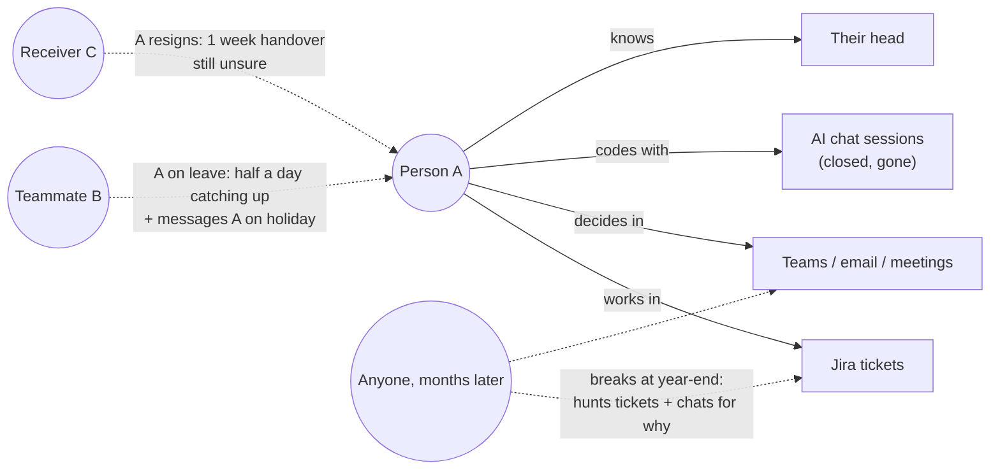
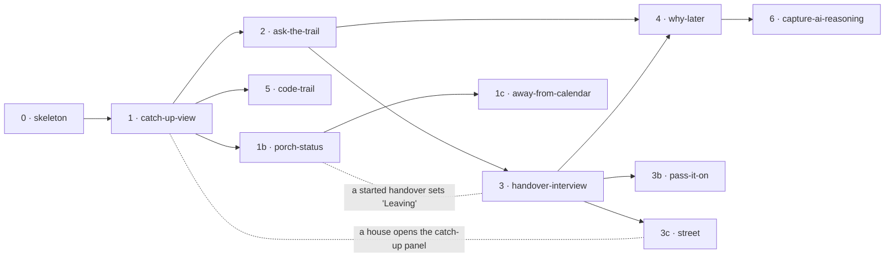
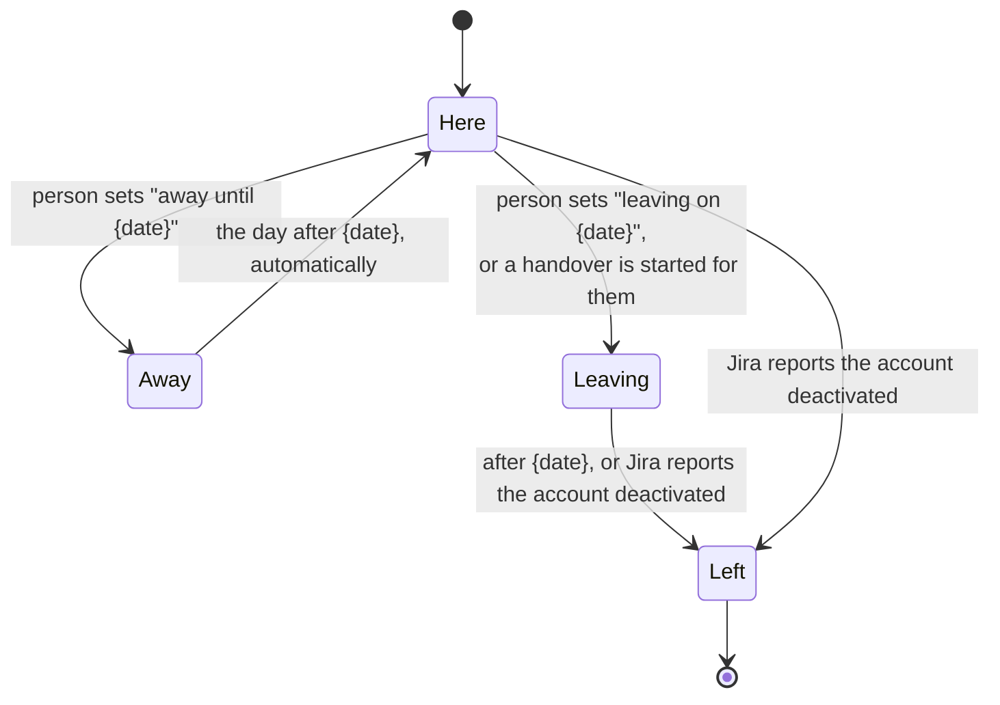

# Knowledge handover

**Project type:** web UI inside Jira (Forge app, Custom UI views), with an LLM path from slice 2 · **Status:** Shaped

Codegeist 2026 entry, category **Software Teams**. Deadline Dec 23, 2026, 4:00am GMT+8.

## Problem

On a project team (POs, devs, testers), what each person is working on, and why, lives in their head and is scattered across Jira tickets, chats and documents. So every absence costs time: covering someone on leave takes half a day of catching up plus messages to them on holiday, a resignation takes a week of handover that still leaves the receiver unsure, and when something breaks months later the team hunts for reasons that left with the person. AI coding makes this worse: code gets written faster, but the reasoning stays in chat sessions that nobody keeps.

**Success moment (the video):** one project, three moments across a year.

1. **Leave.** A teammate opens their partner's work and sees what they were doing, where it stands and what is next, in minutes, with no message to the person on leave.
2. **Resign or move.** A handover that took a week takes a day. The leaver answers only what the app could not fill itself, and the receiver says they are confident.
3. **Breaks later.** Someone asks "why was this built this way?" and gets the reason and its evidence, after the person has left.

**Team numbers (from the user's team, not industry facts):** leave once a month, at least half a day lost each time; resign or move 2–3 times a year, at least one week each; breaks at mid-year and year-end, with a hunt through tickets and chats.

**Outside evidence** (full table in `diagrams.html` sections 15–16):

- Atlassian State of Teams 2025 (12,000 workers): 25% of time spent searching for answers; 56% say the only way to get information is to ask someone or book a meeting.
- Atlassian State of DevEx 2025 (3,500 devs): finding information is the #1 developer friction, ahead of technical debt.
- Avelino et al., ICPC 2016: 65% of 133 popular GitHub systems have a truck factor of 2 or less.
- Rigby et al., ICSE 2016: leavers take the knowledge of their decisions; the right successor is found only 34–48% of the time.
- Anthropic RCT, Jan 2026: devs using AI understood the code they had just written significantly less.
- Stack Overflow 2025: 46% distrust AI accuracy, so every answer must show its source.

## Today

The knowledge sits with one person and in places nobody can search, so every absence becomes a hunt or an interruption.

## Slices

| # | Slice | What ships | Why this order |
|---|-------|-----------|----------------|
| 0 | skeleton | A new Forge app with one Custom UI global page that saves and shows one item from Forge storage, deployed and installed on the dev site, with one end-to-end test. | Greenfield: proves the rails (create, Custom UI, storage, deploy, install, test) before any real work. |
| 1 | catch-up-view | Pick a teammate and see their open work, latest changes, blockers and next steps, read from Jira as the viewer. Every line links to its ticket. | Video moment 1 (leave). Smallest thing worth shipping, and it needs no AI. |
| 1b | porch-status | Each teammate's porch light shows their presence: Here (off), Away until a date, Leaving on a date, or Left (on). People set their own status; Left comes from Jira when an account is deactivated. Shown on the 3D street, name tags, dock and panel. Rules below. | Added 2026-11-02 after the design system made the porch light mean presence (D9). Small, and it can fold into catch-up-view if time is short. Needs only the skeleton's storage. |
| 1c | away-from-calendar | Set a person's porch light to Away automatically from an out-of-office event in their connected calendar, read through Teamwork Graph (`ExternalCalendarEvent`, eventType `OUT_OF_OFFICE`) as the viewer. | Added 2026-11-07 at /spec porch-status (O7): Jira has no out-of-office field, and Teamwork Graph's calendar events are early access. Aims at the Teamwork Graph bonus. Needs porch-status. |
| 2 | ask-the-trail | A Rovo agent answers "catch me up on A" from the same Jira trail, and every answer cites its source tickets. | Rovo bonus. Slices 3 and 4 reuse this agent. |
| 3 | handover-interview | The app lists the gaps only the leaver can fill. The agent interviews the leaver, stores the answers with their source, and writes a standard handover pack to Confluence. | Video moment 2 (resign). Needs the agent from slice 2. |
| 3b | pass-it-on | Every area of a leaver's work gets a new owner. The leaver proposes a teammate, the teammate accepts, and the team lead approves; then the light moves from the leaver's house to the receiver's, and the receiver's house gains a window. Areas still unowned on the leaving date stay on the leaver's house, marked "unowned". | Added 2026-11-02: a resignation or move must pass everything to the team, not only capture it (D11). Needs handover-interview's captured areas. |
| 3c | street | The 3D street of windows (D7): one house for each person on the team list, one window for each area, lit when captured. Opening a house opens that person's catch-up panel. | Added 2026-11-07 at /spec catch-up-view (D17): lit windows mean captured knowledge, so the street needs handover-interview's areas first. |
| 4 | why-later | From any ticket, "why is it like this?" is answered from the trail, the interviews and the handover packs, after the person has left. An issue panel shows it. | Video moment 3 (breaks later). With slices 1–4, all three moments work. |
| 5 | code-trail | Bitbucket commits and pull requests join the trail, linked to their tickets. | Adds what actually changed in code. Works without it, so it comes after the three moments. |
| 6 | capture-ai-reasoning | A Forge MCP server lets Claude Code write its reasoning to the ticket as it works, so the "why" no longer dies with the chat. | The answer to the AI-era sentence of the problem, and the MCP bonus. Needs the store from slice 4. |

Eleven slices including the skeleton, porch-status, away-from-calendar, pass-it-on and street, five over the guideline of about six. The user chose to keep pass-it-on separate from handover-interview (2026-11-02), and the street separate from catch-up-view (2026-11-07, D17). porch-status is small and can fold into catch-up-view. If time runs short, slices 0–4 still make a complete submission.

### A handover is done when every window is lit AND passed on

```mermaid
stateDiagram-v2
    [*] --> Gap: area exists, not captured
    Gap --> Captured: interview answer saved (handover-interview)
    Captured --> Proposed: leaver proposes a receiver
    Proposed --> Accepted: receiver accepts
    Proposed --> Captured: receiver declines
    Accepted --> PassedOn: team lead approves; the light moves to the receiver's house
    Captured --> Unowned: leaving date passes with no new owner
    Gap --> Unowned: leaving date passes, never captured
```

- A leaver's house shows two meters and a countdown: captured (lit) and passed on, for example "14 of 20 captured · 9 of 20 passed on · 28 days left".
- Houses grow with the number of areas a person owns. No cap: 20 areas is a 10-storey building (D10). Receiving an area adds a window to the receiver's house.
- After the leaving date the house stays, porch on (Left). Passed-on windows show where they went; unowned ones are marked so the team can spot them.

### Porch light: who is away (draft rules for porch-status)

The porch light is on when the person is away or leaving (D9). This is how Porchlight decides it.

| Status | Porch light | How it is set | How it ends |
| --- | --- | --- | --- |
| Here | Off | The default | — |
| Away until {date} | On | The person sets it in Porchlight (O17: may a team lead set it for them?) | Automatically, the day after the date |
| Leaving on {date} | On | The person sets it, or it is set when a handover interview is started for them (handover-interview) | Becomes Left after the date |
| Left | On, and stays on | Automatic: Jira reports the account as deactivated (`active: false`) | Never. The house stays, so their knowledge stays |

**Never:** inferring presence from activity, such as "no Jira updates for 5 days, so away". That would watch people, and the brief says Porchlight must never feel like surveillance.

**Maybe later:** reading an out-of-office status from Atlassian (O19), or from a calendar or Teams (needs outside calls, which D5 rejects). Slice 6 stays because it answers the problem's AI-era sentence. If time runs short, slices 0–4 are a complete submission.

**Design rule from the evidence:** every answer links to its source (ticket, PR, page or interview). No bare AI summaries.

## Not doing

- **Live pull from Teams, SharePoint or email.** It needs Microsoft OAuth and admin consent on the judges' site. The interview captures what those sources hold.
- **The "project brain" with a PO, dev and tester flow (zuko for everyone).** It is a second product. It came up first, and this handover idea replaced it.
- **The truth keeper and the self-closing JSM loop.** They are common ideas in the agentic era, and the user was not excited by them.
- **Specialized Industries with an audit framing.** The core need is not finance-specific. See D1.
- **A free-form project map.** The wow visual is chosen in slice 1 (O13), not as its own slice.
- **Calls to outside services, including outside LLM APIs.** See D5.

## Open items

| ID | What | Type | Raised at | Owner | Status | Answer |
| -- | ---- | ---- | --------- | ----- | ------ | ------ |
| O1 | Do Rovo agents from a Forge app run on the dev site and on the judges' site? | unproven | shape | poc | Handed to ask-the-trail | /poc 2026-11-07: yes where Rovo is on. dzaffren.atlassian.net (free site, Gmail account) has no Rovo Chat, so no agent can run there. On the free Forge demo site one-atlas-jddo.atlassian.net (expires 2027-02-05) a minimal hello-forge `rovo:agent` with one `action` installed, showed in Browse agents, and answered with the action's text. No extra scope; the build stayed eligible for Runs on Atlassian. Judges need a site with Rovo (Standard or above, or a demo site); say so in the submission. Spike code deleted. |
| O2 | Can one Forge app span Jira and Confluence (write the handover pack)? | unproven | shape | poc | Handed to handover-interview | /poc in that slice, 2026-11-01 |
| O3 | Can the same Forge app also read Bitbucket? | unproven | shape | poc | Handed to code-trail | /poc in that slice, 2026-11-01 |
| O4 | How the Forge MCP server module works today, and whether Claude Code can connect and write to it | unproven | shape | poc | Handed to capture-ai-reasoning | /poc in that slice, 2026-11-01 |
| O5 | Seeing a teammate's trail can feel like being watched | flag | shape | user | Resolved | The app calls Jira as the user, so a viewer sees only what they already have permission to see. Pitch it as handover, not monitoring. 2026-11-01 |
| O6 | Where the app lives in Jira | question | shape | user | Resolved | A Jira global page ("Team handover"), because a person's work spans projects. An issue panel comes in why-later. D4. 2026-11-01 |
| O7 | UI Kit only, or Custom UI? | question | shape | user | Resolved | Custom UI for the visual views, to make it visually wow. This overrides the UI Kit-only rule in hello-forge/AGENTS.md for this app. D2. 2026-11-01 |
| O8 | `forge create` offers only UI Kit templates | flag | shape | user | Handed to skeleton | Create from the closest UI Kit template, then add a Custom UI resource, 2026-11-01 |
| O9 | No calls outside Forge, so the app keeps the "Runs on Atlassian" badge | assumption | shape | user | Resolved | Yes. D5. 2026-11-01 |
| O10 | Demo data for the video and the judges' site | flag | shape | user | Resolved | A made-up project and team only, never real work data. 2026-11-01 |
| O11 | How to run an end-to-end test against a Forge app | question | shape | user | Handed to skeleton | Decided at /spec skeleton, 2026-11-01 |
| O12 | Go for the Marketplace listing bonus? | question | shape | user | Handed to capture-ai-reasoning | Decide once slices 1–4 work, 2026-11-01 |
| O13 | What is the "wow" visual (for example, a knowledge map where red means only one person knows it)? | question | shape | user | Handed to catch-up-view | Chosen at /spec catch-up-view pause 2, from rendered mockups, 2026-11-01 |
| O14 | Design system for Custom UI: Atlassian design tokens, or /design-system first? | question | shape | user | Handed to catch-up-view | Decided before the first UI slice, 2026-11-01 |
| O15 | No outside study backs "a handover takes a week" | flag | shape | user | Accepted risk | Present it as the user's team's number, not an industry fact. 2026-11-01 |
| O16 | Which Codegeist category? | question | shape | user | Resolved | Software Teams. D1. 2026-11-01 |
| O17 | Who may set a teammate's status: only the person, or a team lead too? | question | shape | user | Handed to porch-status | Decided at /spec porch-status, 2026-11-02 |
| O18 | Can the app read whether a Jira account is deactivated (`active: false`), calling Jira as the viewer? | unproven | shape | poc | Handed to porch-status | /poc in that slice, 2026-11-02 |
| O19 | Does Atlassian expose an out-of-office or working-status field a Forge app can read? | unproven | shape | poc | Handed to porch-status | /poc in that slice; if yes, it can set Away automatically, 2026-11-02 |
| O20 | A resignation may be confidential before it is announced, and "Leaving" shows it to the whole team | flag | shape | user | Handed to porch-status | Decide who sees "Leaving" before the announcement date, 2026-11-02 |
| O21 | Who is the "team lead" that approves a pass-on: the Jira project lead, or a role set in Porchlight? | question | shape | user | Handed to pass-it-on | Decided at /spec pass-it-on, 2026-11-02 |
| O22 | What if the leaver is the team lead, or the lead is away? | question | shape | user | Handed to pass-it-on | Decided at /spec pass-it-on, 2026-11-02 |
| O23 | A 10-storey house must still frame well: camera height, name tag above the roof, panel list length | flag | shape | user | Handed to pass-it-on | Tall towers accepted (D10); the camera and panel adapt in that slice, 2026-11-02 |
| O24 | When an area is passed on, does it keep its history (original owner, sources) on the receiver's house? | question | shape | user | Handed to pass-it-on | Decided at /spec pass-it-on, 2026-11-02 |
| O25 | @mention teammates in notes and areas (search Jira users, store who was mentioned, and how they find out; Jira's notify API only works on issues) | question | spec skeleton p2 | user | Handed to pass-it-on | Mentions belong where knowledge is sent to a named person; notification needs a /poc there, 2026-11-02 |

## Glossary

- **Forge** — Atlassian's platform for apps that run inside Jira, Confluence and the other products, hosted by Atlassian.
- **UI Kit** — Forge's ready-made screen parts (Button, Box, table…). Looks native, but cannot draw free shapes.
- **Custom UI** — a Forge screen built from your own HTML, CSS and JavaScript, shown in a sandboxed frame inside Jira.
- **Rovo agent** — an Atlassian AI helper with a prompt and actions. A Forge app can add one.
- **MCP server** — a standard way for AI tools such as Claude Code to call an app's functions.
- **Truck factor (bus factor)** — how many people must leave before a project stalls.
- **Trail** — the record of a person's work: tickets, comments, status changes, commits, interviews.
- **Handover pack** — the standard handover document the app writes to Confluence.
- **Runs on Atlassian** — a badge for apps that send no data outside Atlassian's cloud.
- **Walking skeleton** — the thinnest end-to-end version of the app, deployed, that proves the setup works.
