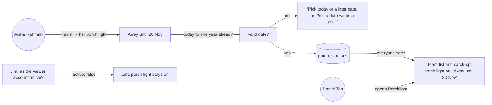
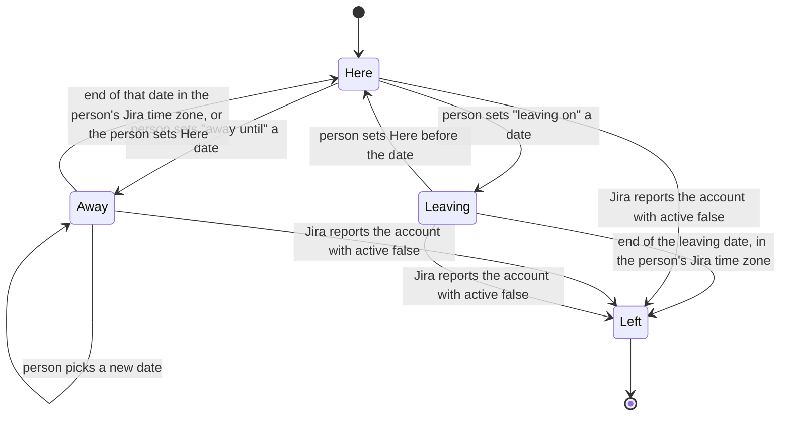
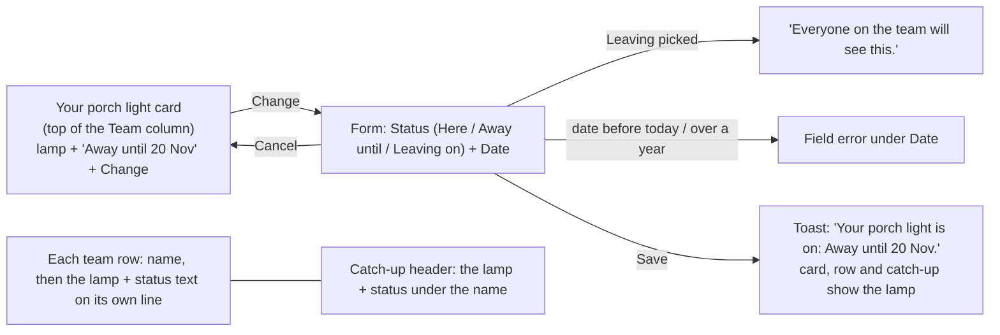
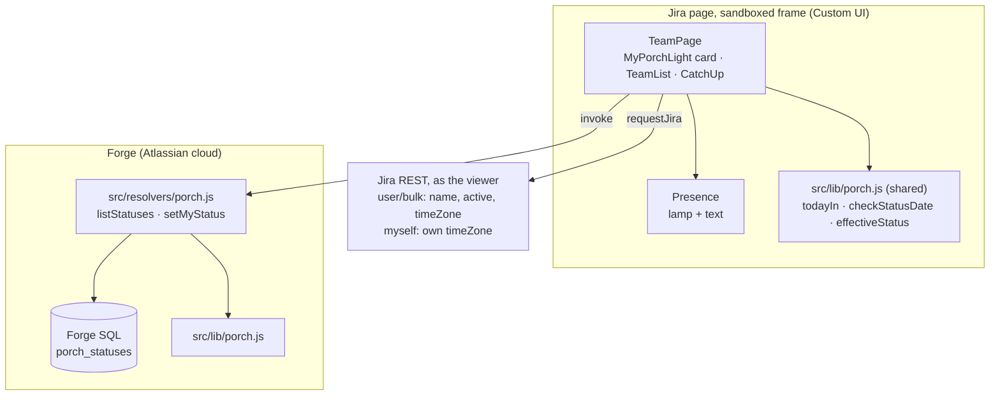
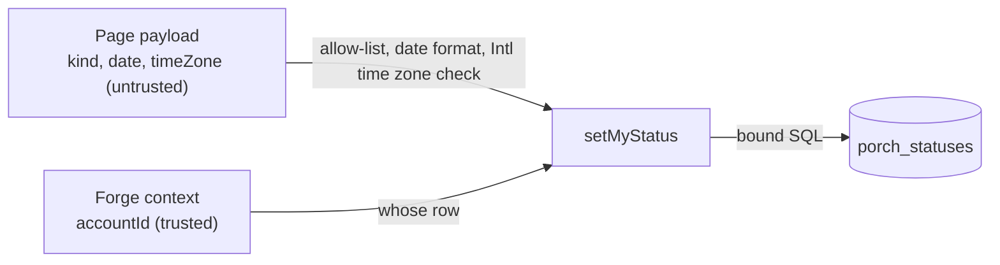
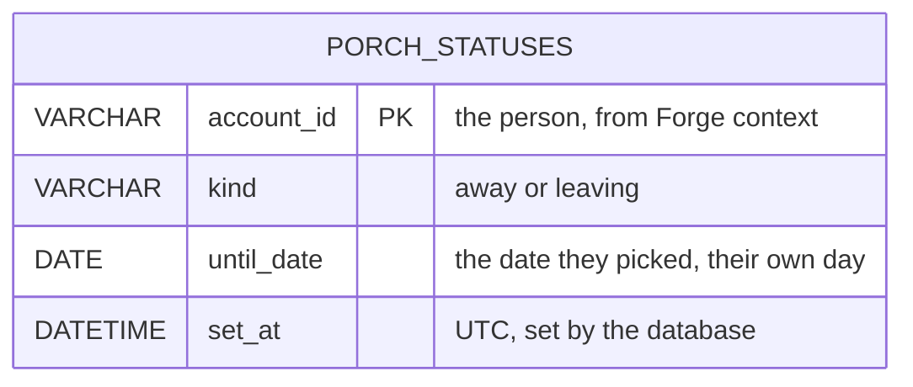

# Porch status

**Version:** v1 · **Status:** Built · **Type:** Feature · **Project type:** Web UI

**Shape doc:** docs/specs/knowledge-handover/shape.md
**Depends on:** catch-up-view

Each person can turn on their own porch light: Away until a date, or Leaving on a date. Everyone sees it on the team list and in the catch-up, and it turns into Left after the leaving date or when Jira deactivates the account. It tells a teammate whether to read someone's work or just ask them, which is what the porch light means (D9).

## Problem

catch-up-view shows a teammate's work, but not whether that teammate is here. Daniel cannot tell whether he should message Aisha or read her catch-up, so he still messages her on holiday. On the user's team someone is on leave about once a month, and each time costs at least half a day. The porch light is Porchlight's one signal for this, and today it means nothing.

## Slice test

| Check                         | Result |
| ----------------------------- | ------ |
| Cuts every layer it needs     | Yes. A status control and the porch light on the Team page, resolvers, a statuses table in Forge SQL, and Jira's account state read as the viewer. |
| One e2e test walks it         | Yes. Set Away until a date, see the porch light on your row and in your catch-up, set Here again. |
| Worth shipping alone          | Yes. Daniel sees that Aisha is away until 20 Nov and reads her catch-up instead of messaging her. |
| Fits (≤5 scenarios, ≤2 areas) | Yes. 5 scenarios, 2 areas: the status store and the porch light on screen. |

**Path:** full. The slice adds new stored data and changes two screens.

## User story

As a member of a project team, I want to leave my porch light on when I am away or leaving, so that my teammates read my work instead of messaging me.

## Flow



Aisha sets her own porch light to Away until 20 Nov. A date from today up to a year ahead is saved, and everyone then sees her porch light on. A Leaving date that has passed, or an account that Jira reports as deactivated, shows as Left.

## States



A person moves between Here, Away and Leaving themselves. Away ends on its own at the end of its date. Left comes only from a passed leaving date or a deactivated account, and nobody can undo it.

| Status | Porch light | Text | How it is set | How it ends |
| --- | --- | --- | --- | --- |
| Here | Off | — | The default, or the person sets it | — |
| Away until a date | On | "Away until 20 Nov" | The person | End of that date in their Jira time zone, or they set Here |
| Leaving on a date | On | "Leaving on 31 Jan" | The person; everyone sees it from that moment | Becomes Left at the end of that date |
| Left | On, and stays on | "Left" | A passed leaving date, or Jira reports `active: false` | Never |

## Acceptance criteria

The site is `handover-demo.atlassian.net`, with a made-up team (shape O10). Today is 7 November 2026. Aisha Rahman, Daniel Tan, Ravi Kumar and Mei Ling Goh are on the team list.

```gherkin
Scenario: Leave the porch light on while away
  Given Aisha Rahman's porch light is off
  When Aisha sets her porch light to "Away until 20 Nov 2026"
  Then her row on the team list shows the porch light on and "Away until 20 Nov"
  And Daniel Tan sees the same on her row and at the top of her catch-up
  And Daniel has no control to change Aisha's porch light

Scenario: Away ends by itself, or earlier when the person is back
  Given Aisha Rahman is "Away until 20 Nov 2026", and her Jira time zone is Asia/Kuala_Lumpur
  When it is 21 Nov 2026 00:00 in Kuala Lumpur
  Then her porch light is off and her row shows no status
  And if Aisha sets her porch light to Here on 18 Nov, it is off from that moment

Scenario: Leaving becomes Left after the leaving date
  Given Ravi Kumar sets his porch light to "Leaving on 31 Jan 2027"
  And the form told him "Everyone on the team will see this."
  When Daniel Tan opens Porchlight on 10 Nov 2026
  Then Ravi's row shows the porch light on and "Leaving on 31 Jan"
  And from 1 Feb 2027 in Ravi's time zone his row shows "Left", with the porch light on
  And nobody can change Ravi's porch light after that

Scenario: An account Jira deactivates shows as Left
  Given Mei Ling Goh's porch light is off
  And Jira reports her account with active false
  When Daniel Tan opens Porchlight
  Then Mei Ling's row shows "Left", with the porch light on
  And if Jira leaves her out of its answer instead, her row keeps her last status, never a wrong "Left"

Scenario: A date outside today to one year ahead is not saved
  Given Aisha Rahman is setting her porch light
  When she picks "Away until 2 Nov 2026"
  Then she sees "Pick today or a later date." and nothing is saved
  And when she picks "Leaving on 10 Dec 2027", she sees "Pick a date within a year." and nothing is saved
```

## Scope

**In:**

- One porch light per person, stored in Porchlight: Here, Away until a date, or Leaving on a date. Only the person can set their own (O1).
- Dates from today up to one year ahead, in the person's own day.
- Away ends at the end of its date in the person's Jira time zone. Leaving becomes Left at the end of its date.
- Left also when Jira reports the account with `active: false`. Left is final.
- A person can change Away or Leaving, or set Here, any time before Left.
- The porch light shows on each team-list row and at the top of the catch-up, with its text.
- "Everyone on the team will see this." on the form before saving Leaving (O2).

**Out:**

- The porch lamp on the 3D street and its name tags. → street (3c)
- Setting Away automatically from an out-of-office calendar. → away-from-calendar, a new slice (O7)
- A handover interview setting Leaving. → handover-interview
- A team lead setting someone's status, or seeing Leaving before others. → no slice; the person controls it (O1, O2)
- Notifications when someone's porch light changes. → no slice yet
- Inferring presence from Jira activity. → never (shape: "Never")

## Interface

Two changes to the Team page, both built from the design system.



Your own porch light is a card at the top of the Team column. Change opens a small form in place with a status and a date. Saving shows a toast, and the lamp lights on your card, your row and your catch-up header. Everyone else's lamp shows on their row and at the top of their catch-up, and nobody else gets a control.

| Scenario | State in the preview |
| --- | --- |
| Leave the porch light on while away | Team with porch lights (Aisha's card, row and catch-up); Setting Away |
| Away ends by itself, or earlier | Change → Status Here → Save (lamp off, "Your porch light is off.") |
| Leaving becomes Left after the leaving date | Leaving warning; Ravi is leaving |
| An account Jira deactivates shows as Left | Mei Ling left |
| A date outside today to one year ahead | Past date; Over a year |

**Texts:** "Away until 20 Nov", "Leaving on 31 Jan", "Left"; on your own card when off, "Here, porch light off". Form help: Away "Your porch light turns off by itself after this date.", Leaving "Everyone on the team will see this.", Here "Your porch light is off: teammates just ask you." Toasts: "Your porch light is on: Away until 20 Nov." and "Your porch light is off." A failed save: "Couldn't save your porch light. Try again."

**Motion tier:** 1 (approved 2026-11-07). The lamp switches at once, with a toast. Tier 2 (the lamp warming up over 600ms) was tried in the preview and dropped: on an 8px lamp it could not be seen.

**Components used:** `pl-presence`, `pl-presence--away`, `pl-presence__lamp`, `pl-field`, `pl-field__label`, `pl-select`, `pl-input` (date), `pl-field__help`, `pl-field--error`, `pl-btn--primary` (Save, with the lamp glyph), `pl-btn--secondary` (Change), `pl-btn--subtle` (Cancel), `pl-toast`, and the team list and catch-up pieces from catch-up-view. No new components.

**Preview:** `docs/design/porch-status/preview.html` (http://localhost:3000/design/porch-status/preview.html). The state bar is for review only. It also shows the rejected header placement and the rejected tier 2.

**Security note for build:** status text is built by Porchlight from a fixed kind and a date, never from typed text.

## Technical plan

### Approach

Porchlight stores only what a person chose: one row per person in a new `porch_statuses` table with a kind (away or leaving) and a date. Here is no row. Here-after-Away and Left are never stored; they are worked out each time the page reads a status, from the date, the person's Jira time zone and Jira's `active` flag (D26). The time zone and `active` come from the bulk user lookup the Team page already makes for names, so nothing personal that Jira owns is copied (D12, D27). One shared file, `src/lib/porch.js`, holds the date rules, so the page and the resolver use the same code, like `src/lib/validate.js` for notes.

Relies on: D2, D9, D12, D14, D15, D16, D19, D21, D24, D25, and D26–D27 drafted below.



The page saves and reads raw choices through two resolvers, and asks Jira for each person's time zone and active flag. The shared rules then turn the pair into Here, Away, Leaving or Left.

```mermaid
sequenceDiagram
    participant A as Aisha (browser)
    participant TP as TeamPage
    participant R as setMyStatus
    participant DB as porch_statuses
    participant J as Jira (as the viewer)
    A->>TP: Away until 20 Nov, Save
    TP->>TP: checkStatusDate in her time zone, else field error
    TP->>R: invoke setMyStatus with kind, date and her time zone
    R->>R: accountId from context; same date check; refuse if already Left
    R->>DB: upsert her one row (or delete it for Here)
    R-->>TP: saved
    TP->>R: listStatuses
    TP->>J: user/bulk for members: name, active, timeZone
    TP->>TP: effectiveStatus per person, now
    TP-->>A: lamp on her card, row and catch-up, toast
```

On Save, the page and the resolver both check the date in Aisha's time zone, and the resolver writes only her own row. Every read then joins the stored choices with Jira's time zone and active flag to show the right lamp.



Nobody can write another person's row: the row key comes from Forge's context. The kind is an allow-list, the date a strict format, and the time zone must be one that `Intl` knows. No typed text is stored or shown.

### Changes

Paths are under `Codegeist/porchlight/` unless they start at the repo root.

| File | What changes | Why |
| ---- | ------------ | --- |
| `src/lib/porch.js` (new) | `todayIn(timeZone, now)` gives a "YYYY-MM-DD" day with `Intl.DateTimeFormat`; `checkStatusDate(kind, date, today)` gives ok, "Pick today or a later date." or "Pick a date within a year."; `effectiveStatus(row, person, now)` gives here, away, leaving or left | Scenarios 1–5; shared like `src/lib/validate.js` |
| `src/db/migrate.js:56` | Enqueue `v003_create_porch_statuses` after v002; `rollbackV003()` like `rollbackV002()` at line 124 | Scenarios 1–3 |
| `src/db/porch.js` (new) | `listStatuses()` (`LIMIT 500` written in, as `notes.js` does), `upsertStatus(accountId, kind, date)` with `ON DUPLICATE KEY UPDATE`, `deleteStatus(accountId)`, `getStatus(accountId)` | Scenarios 1–3 |
| `src/resolvers/porch.js` (new) | `listStatuses`; `setMyStatus` checks kind, date and time zone, refuses a change once the stored Leaving date has passed (error `left`), logs `porchlight.status.set kind=<kind> by=<id>`; reuses `signedInAccountId` (`src/resolvers/context.js`) and `ensureMigrated` | Scenarios 1, 2, 3, 5 |
| `src/resolvers/index.js:16` | Define the two resolvers | Wiring |
| `static/porchlight-ui/src/api.js` | `fetchStatuses`, `setMyStatus` (invoke); `fetchPeople(ids)` returns name, active and time zone per person from the batched `user/bulk` (`fetchDisplayNames` keeps working for notes); `fetchMyself` also returns `timeZone` | Scenarios 1–4 |
| `static/porchlight-ui/src/Presence.jsx` (new), `MyPorchLight.jsx` (new) | The lamp with its text; the "Your porch light" card and its form, from the preview | Scenarios 1, 2, 3, 5 |
| `static/porchlight-ui/src/TeamPage.jsx`, `TeamList.jsx`, `CatchUp.jsx` | Read statuses with the team (same newest-read rule); the card above the team list; the lamp on each row and in the catch-up header | Scenarios 1–4 |
| `static/porchlight-ui/src/app.css` | The name-line and card layout from the preview | Pause 2 |
| `test/unit/porch.test.js`, `test/unit/porch-lib.test.js` (new), `fake-forge-sql.js`, `migrate.test.js` | Resolver rules, the date and time-zone rules, the new statements, v003 forward, back, forward | Scenarios 1–5 |
| `static/porchlight-ui/src/MyPorchLight.test.jsx`, `Presence.test.jsx` (new), `TeamPage.test.jsx`, `api.test.js` | Form, errors, warning, lamp on rows and header, Left from `active: false`, a missing person keeps the last status | Scenarios 1–5 |
| `e2e/porch-status.spec.js` (new) | The walk below | E2E |
| `Codegeist/docs/ARCHITECTURE.md`, `Codegeist/OVERVIEW.md` | The new table, resolvers and pieces | Docs |

Reusing: `signedInAccountId`, `ensureMigrated`, the fixed-LIMIT rule, the batched `user/bulk` lookup (`fetchDisplayNames`), the newest-read rule in `TeamPage.jsx`, `Toast`, the fake database with Forge's real `MigrationRunner`, and `e2e/helpers.js`.

### Data



One row per person at most. Here is no row. Time zones, names and `active` are never stored; Jira gives them each time (D12, D27).

**Migration:** expand only. `v003_create_porch_statuses` creates the table if it does not exist: `account_id VARCHAR(128) PRIMARY KEY`, `kind VARCHAR(16) NOT NULL`, `until_date DATE NOT NULL`, `set_at DATETIME NOT NULL DEFAULT CURRENT_TIMESTAMP`. Nothing to backfill or switch.
**Reverse:** `rollbackV003()`: `DROP TABLE IF EXISTS porch_statuses`, then delete the v003 rows from `__migrations`. Tested forward, back, forward with notes and team members untouched.

### Earn-it

| Added | Triggered by |
| ----- | ------------ |
| `porch_statuses` table and two resolvers | Scenarios 1 and 3: a status persists and everyone sees it |
| `src/lib/porch.js` shared by page and resolver | Scenarios 2, 3 and 5: the same date and time-zone rule on both sides |
| Time zone and `active` from `user/bulk` | Scenarios 2, 3 and 4 (O4, O3); the request already exists for names |
| The page sends its own time zone on save | Scenario 5: the resolver checks "today" in the person's day; it cannot call Jira itself (no `@forge/api`, D21) |

No new npm package and no new scope: `read:jira-user` covers `user/bulk` and `myself`.

### Non-functionals

|                      |                                                                               |
| -------------------- | ----------------------------------------------------------------------------- |
| **Load**             | One team of 5–50 people. One extra invoke per Team page load; the `user/bulk` call already happens |
| **Breaks first**     | At 10×, nothing near a limit: `listStatuses` returns up to 500 rows, ten times the team list's 200 |
| **Security surface** | Anyone who can open Porchlight reads all statuses (D24: setting it announces it) and writes only their own row, keyed by Forge's context. Kind is an allow-list, the date a strict "YYYY-MM-DD" in range, the time zone checked with `Intl`. No typed text. Stores an account ID, a kind, a date and when it was set |
| **Proof it works**   | `forge logs -e development` shows `porchlight.status.set kind=away by=<id>`, and once `porchlight.migrate v003_create_porch_statuses=done` |
| **Rollout**          | Development only, no users yet, so no flag. No scope change, so no install upgrade. Rollback: redeploy the previous commit; v003 only adds a table |

### Test plan

| Scenario | Test | Command |
| -------- | ---- | ------- |
| Leave the porch light on while away | `porch.test.js` (row keyed by context, payload accountId ignored) + `MyPorchLight.test.jsx` + `Presence.test.jsx` + e2e | `npm test` · `npm run test:ui` · `npm run e2e` |
| Away ends by itself, or earlier | `porch-lib.test.js` (Asia/Kuala_Lumpur: 20 Nov 23:59 is away, 21 Nov 00:00 is here) + `porch.test.js` (Here deletes the row) + e2e | `npm test` · `npm run e2e` |
| Leaving becomes Left after the leaving date | `porch-lib.test.js` (31 Jan is leaving, 1 Feb is left) + `porch.test.js` (a change after that answers `left`) | `npm test` |
| An account Jira deactivates shows as Left | `porch-lib.test.js` (`active: false` is left) + `TeamPage.test.jsx` (a person missing from Jira's answer keeps the last status) | `npm test` · `npm run test:ui` |
| A date outside today to one year ahead | `porch-lib.test.js` (yesterday, today, +365 days, +366 days) + `porch.test.js` + `MyPorchLight.test.jsx` (both messages) | `npm test` · `npm run test:ui` |

**E2E:** `e2e/porch-status.spec.js` opens Porchlight > Team with the saved login, sets "Away until" a date one week ahead, checks the lamp text on "Your porch light" and on the person's own row, reloads to prove it came from the database, then sets Here and checks the lamp is off. Run with `npm run e2e` after `forge deploy`.

### Chunks

| Chunk | Scenarios | Files owned |
| ----- | --------- | ----------- |
| A · status data | 1, 2, 3, 5 (server) | `src/` (including `src/lib/porch.js`), `test/unit/`, `package.json`, `package-lock.json` |
| B · page | 1–5 (page) | `static/porchlight-ui/` (its own `package.json` and lockfile) |
| C · e2e and docs | E2E | `e2e/`, `Codegeist/docs/ARCHITECTURE.md`, `Codegeist/OVERVIEW.md` |

A owns `src/lib/porch.js`; B imports it through the `@lib` alias and never edits it. No manifest change.

### Risks

| Risk | Mitigation |
| ---- | ---------- |
| Jira hides another person's time zone (O10) | `effectiveStatus` falls back to the viewer's own time zone; a unit test covers it |
| Forge's runtime lacks time-zone data for `Intl` (O11) | The resolver answers `bad_request` for a zone it cannot use; the first deploy and the e2e prove the real runtime |
| `user/bulk` leaves a deactivated person out (O3) | Show Left only on `active: false`; a missing person keeps the last status |
| A device clock is wrong, so the lamp turns off a day early or late | Display only; the resolver's date check uses the server clock |

## Open items

| ID | What | Type | Raised at | Owner | Status | Answer |
| -- | ---- | ---- | --------- | ----- | ------ | ------ |
| O1 | Who may set a teammate's status: only the person, or a team lead too? (from shape O17) | question | shape | user | Resolved | Only the person sets their own porch light. A lead who wants someone marked away asks them. D24. 2026-11-07 |
| O2 | A resignation may be confidential before it is announced, and "Leaving" shows it to the whole team (from shape O20) | flag | shape | user | Resolved | Setting Leaving is announcing it: everyone sees it from the moment the person sets it, and the form says "Everyone on the team will see this." D24. 2026-11-07 |
| O3 | Can the app read whether a Jira account is deactivated (`active: false`), calling Jira as the viewer? (from shape O18) | unproven | shape | poc | Accepted risk | Research 2026-11-07: `GET /rest/api/3/user/bulk` returns `User` objects with `active`, needing only "Permission to access Jira" and `read:jira-user`; `/user/search` returns active users only; there is no Forge deactivation event (ECO-1492, Gathering Interest). Unproven: whether bulk still returns a deactivated account. Safe rule: show Left only on `active: false`; a missing person keeps their last status. Test on a real deactivated account before the demo. 2026-11-07 |
| O4 | When exactly does "Away until 20 Nov" end? | question | spec p1 | user | Resolved | At the end of that date in the person's own Jira time zone. Leaving becomes Left the same way. 2026-11-07 |
| O5 | Which dates may someone pick? | question | spec p1 | user | Resolved | Today up to one year ahead. Earlier: "Pick today or a later date." Later: "Pick a date within a year." 2026-11-07 |
| O6 | Can someone change their mind after setting Away or Leaving? | question | spec p1 | user | Resolved | Yes, until it becomes Left: switch to Here or pick a new date. Left is final. 2026-11-07 |
| O7 | Does Atlassian expose an out-of-office or working status a Forge app can read? (from shape O19) | unproven | shape | poc | Resolved | Research 2026-11-07: Jira REST has no such field, and the native feature is not built (ID-7594, Gathering Interest). Teamwork Graph has `ExternalCalendarEvent` with eventType `OUT_OF_OFFICE`, scope `read:graph:calendar-event:external`, read with `requestTeamworkGraph` as the viewer, but it is early access and needs an outside calendar connected. Not in this slice: the user chose a later slice, away-from-calendar, added to the shape. 2026-11-07 |
| O8 | Where does a person set their own porch light? | question | spec p2 | user | Resolved | A card at the top of the Team column, with a Change button that opens a small form in place. D25. 2026-11-07 |
| O9 | Motion tier | question | spec p2 | user | Resolved | Tier 1: the lamp switches at once, with a toast. Tier 2's warm-up was shown and could not be seen on an 8px lamp. 2026-11-07 |
| O10 | Pause 3 needs each person's time zone at read time. Does `/rest/api/3/user/bulk` return `timeZone` for other people, or can profile visibility hide it? | unproven | spec p3 | poc | Accepted risk | Checked 2026-11-07 for the viewer's own account: bulk returns `active: true` and `timeZone: Asia/Kuala_Lumpur`. Not checked for another person. When Jira hides it, `effectiveStatus` uses the viewer's own time zone; at worst the lamp changes a few hours early or late on the last day. Unit-tested. 2026-11-07 |
| O11 | The resolver checks dates in the person's time zone with `Intl`. Does Forge's Node 24 runtime carry full time-zone data? | unproven | spec p3 | poc | Resolved | Official Node builds carry full time-zone data, and Forge runs Node 24. The e2e saves a status with the person's real zone after the first deploy; a failure shows as `bad_request` and is fixed before /review. 2026-11-07 Proven 2026-11-07 at /build: deploy 3.3.0 to development, the e2e saved Away with Asia/Kuala_Lumpur, and `forge logs` showed `porchlight.status.set kind=away`. |
| O12 | The plan did not name `porchlight/playwright.config.js`. With no `workers` value, Playwright ran spec files in parallel, and `catch-up.spec.js` removes and re-adds the same person whose row `porch-status.spec.js` checks. | flag | build | user | Decided alone | Chose: `workers: 1`, so the three e2e files run one after another (1.3 min in all). Other: keep parallel and give each spec its own teammate. Undo: `git revert eb1e134`. 2026-11-07 |
| O13 | The preview shows "Here, porch light off" and "They're here: just ask them too." in the catch-up header for a person who is Here. The spec's Texts list neither for the header. | flag | build | user | Decided alone | Chose: the catch-up header shows nothing for Here, like the team rows. Other: copy the preview. Undo: pass `showHere` to `<Presence>` in `PersonHeader` (`CatchUp.jsx`) and add the meta text. 2026-11-07 |
| O14 | The spec does not say what the Team page shows when `listStatuses` fails. | flag | build | user | Decided alone | Chose: the whole team read fails with the existing "Couldn't load the team." and its Try again, because showing everyone as Here gives the wrong signal. Other: show the team with no lamps. Undo: catch `fetchStatuses` in `readTeam` (`TeamPage.jsx`) and use `[]`. 2026-11-07 |
| O15 | The spec gives no text for a save that fails (network, `bad_request` or `left`). | flag | build | user | Decided alone | Chose: a new message under the form, "Couldn't save your porch light. Try again.", in the Composer pattern; added to Texts. `left` has no special path. Other: reload the page on `left`, so the card turns into Left. Undo: `handleSubmit` in `MyPorchLight.jsx` and `handleSaveStatus` in `TeamPage.jsx`. 2026-11-07 |
| O16 | The spec does not say how the form opens, or what Save does with an empty date. | flag | build | user | Decided alone | Chose: for a person who is Here, the form opens on "Away until" with an empty date; otherwise on their current kind and date. Save with no date shows "Pick today or a later date." Other: default the date to today, or add a "Pick a date." text. Undo: `draftFrom` and `dateMessage` in `MyPorchLight.jsx`. 2026-11-07 |
| O17 | `setMyStatus` decides "already Left" with the time zone that the page sends. A changed request with a zone further west can still change a Leaving status for a few hours after its date passes. | flag | build | user | Decided alone | Chose: accept it. The page cannot be stopped from sending a valid zone, and the resolver cannot ask Jira itself (no `@forge/api`, D21). The lamp everyone sees still uses Jira's zone. Other: look up the zone on the server, which means superseding D21. Undo: a later slice. For /review to judge. 2026-11-07 |

_Never delete this section or its rows. See references/ledger.md._

## Decisions to record

Pause 1: recorded as D24 on 2026-11-07.

Pause 2: recorded as D25 on 2026-11-07.

Pause 3: recorded as D26 and D27 on 2026-11-07.

## Glossary

- **Porch light** — Porchlight's presence signal: on means away or leaving, so read their work; off means here, so just ask them (D9)
- **Deactivated account** — an Atlassian account an admin has turned off; Jira reports it with `active: false`
- **Jira time zone** — the time zone each person sets in their Atlassian profile; Jira returns it as `timeZone`
- **Forge SQL** — a MySQL-compatible database that Atlassian hosts for each installation of the app
- **e2e** — end-to-end: one test that walks the whole slice as a user would
