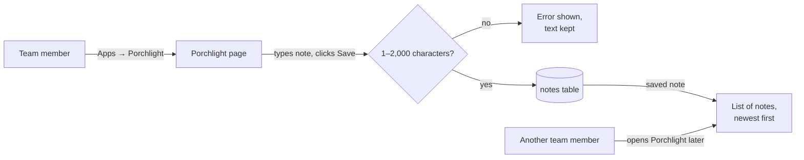
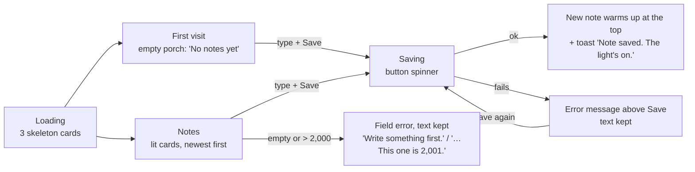
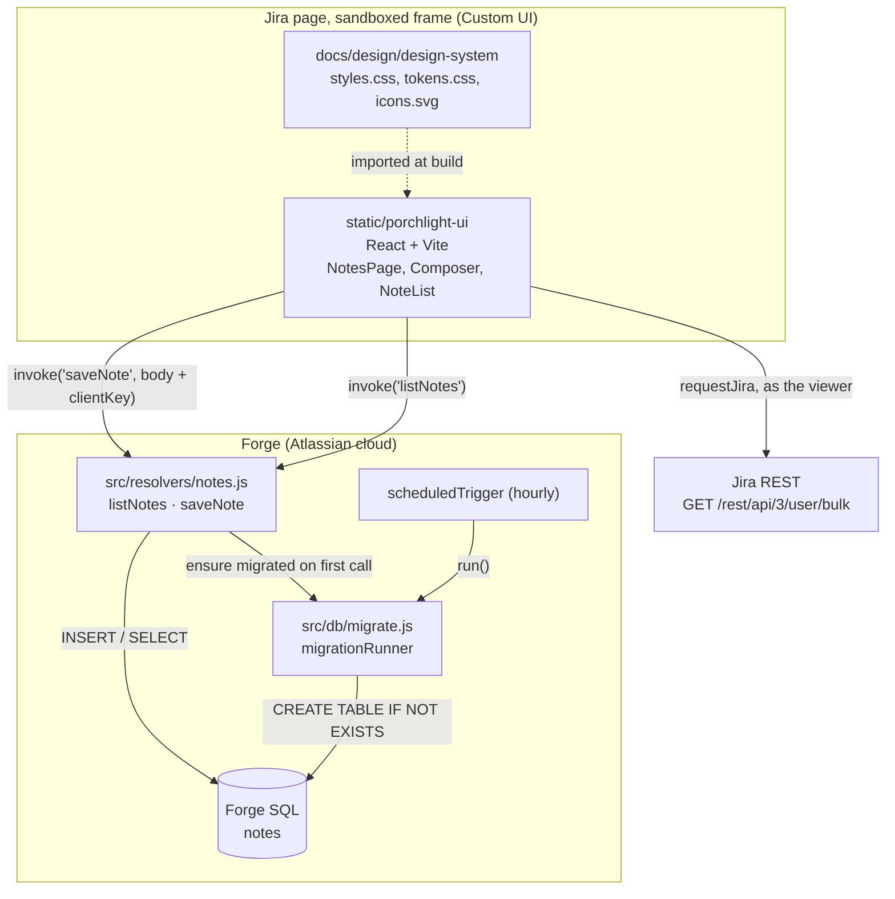
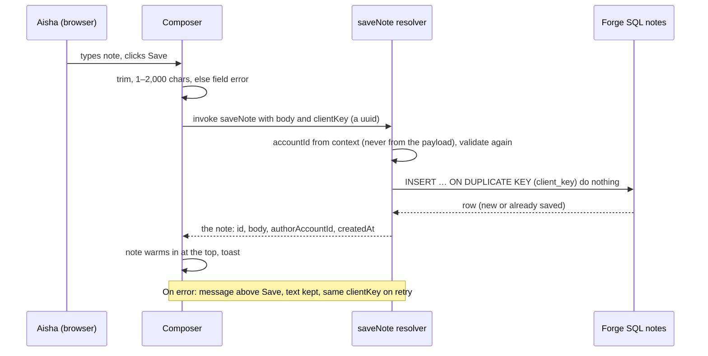
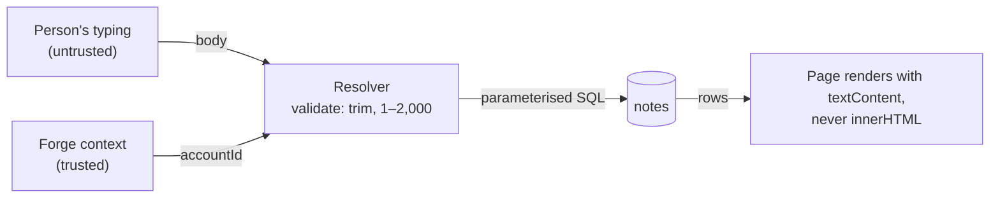
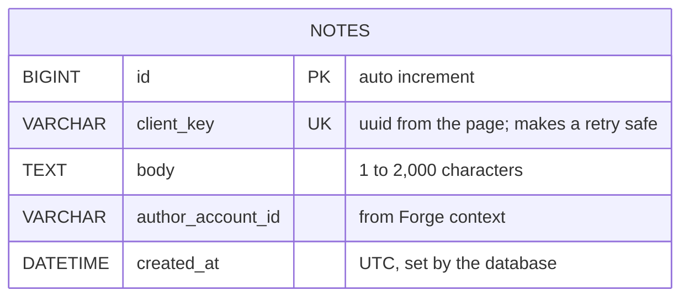

# Skeleton

**Version:** v1 · **Status:** Shipped · **Type:** Skeleton · **Project type:** Web UI

**Shape doc:** docs/specs/knowledge-handover/shape.md
**Depends on:** None

Porchlight's walking skeleton: a "Porchlight" page in Jira where anyone saves a short note and sees every saved note listed back from Forge SQL, deployed by CI and walked by one real end-to-end test. It ships first because every later slice needs these rails, and none of them exist yet.

## Problem

Nothing exists yet: no app, no Custom UI build, no database, no CI, no e2e harness. Every later slice (catch-up-view, ask-the-trail, handover-interview, why-later) needs all of these. Building them inside a feature slice would hide setup problems behind feature problems. This slice proves the rails with almost no feature.

## Stack

The decision record for the whole project. Asked one at a time, 2026-11-01.

| Piece | Choice | Source |
| ----- | ------ | ------ |
| App name | Porchlight, app folder `porchlight/` inside `Codegeist/` | user |
| Host and deploy target | Atlassian Forge cloud, `development` environment, on the user's dev site | `hello-forge/AGENTS.md` |
| Backend runtime | Node.js 24 | `hello-forge/manifest.yml:17` |
| Backend language | Plain JavaScript, with plenty of comments | `hello-forge/AGENTS.md` › Code Style |
| Frontend | Custom UI with React, built by Vite | user (D2 allows Custom UI) |
| Database | Forge SQL | user |
| CI | GitHub Actions: lint and unit tests on every push; deploy to `development` on every merge to `main` | user |
| Unit tests | Vitest | user |
| E2E | Playwright, logging in to the real dev site and walking the app inside Jira | user |
| Package manager | npm | `hello-forge/package-lock.json` |
| Outside calls | None | D5 |

## Slice test

| Check                         | Result |
| ----------------------------- | ------ |
| Cuts every layer it needs     | Yes. Custom UI page, resolver function, Forge SQL table, deploy, CI. |
| One e2e test walks it         | Yes. Log in, open Porchlight, save a note, reload, see it. |
| Worth shipping alone          | Yes, as a skeleton: its value is proven rails. A team could already use it as a shared note board. |
| Fits (≤5 scenarios, ≤2 areas) | Yes. 5 scenarios, 2 areas: the Porchlight page and note storage. |

**Path:** full. This is a greenfield slice 0 that sets the stack for the whole project.

## User story

As a member of a project team, I want to leave a short note on a shared Porchlight page so that anyone on the team can read it later.

## Flow



A team member opens Porchlight from Jira's Apps menu and types a note. A note of 1–2,000 characters is saved and listed newest first, and anyone who opens the page later sees it. Any other note shows an error and keeps the text.

## Acceptance criteria

```gherkin
Scenario: Save a note and a teammate sees it
  Given Aisha Rahman and Daniel Tan both use the site handover-demo.atlassian.net
  And Porchlight has no notes yet
  When Aisha opens Porchlight and saves "Payments retry 3 times because the bank API times out under load."
  Then the note appears at the top of the list with "Aisha Rahman" and today's date
  And when Daniel opens Porchlight later, he sees the same note

Scenario: First visit shows an empty page
  Given Porchlight has no notes yet
  When Daniel Tan opens Porchlight
  Then he sees "No notes yet. Leave the first one for the next person."
  And the Save button is ready to use

Scenario: Empty note is not saved
  Given Aisha Rahman is on the Porchlight page
  When she clicks Save with an empty note, or a note of only spaces
  Then she sees "Write something first."
  And nothing is added to the list

Scenario: Note over 2,000 characters is not saved
  Given Aisha Rahman has typed a note of 2,001 characters
  When she clicks Save
  Then she sees "Notes can be up to 2,000 characters. This one is 2,001."
  And her text stays in the box so she can shorten it
  And nothing is added to the list

Scenario: Save fails
  Given the notes table cannot be reached
  When Aisha Rahman saves "Year-end batch job runs on 31 Dec at 23:00."
  Then she sees "Couldn't save your note. Try again."
  And her text stays in the box
  And the note is not listed twice after she retries and the save works
```

## Scope

**In:**

- A new Forge app named Porchlight, made with `forge create`, with a Jira global page that uses Custom UI (React + Vite).
- One Forge SQL table for notes: the text, the author's account ID and the time it was saved.
- Save a note, list all notes newest first, show the author's name and the date, and the empty and error states above.
- A git repo at `Codegeist/`, a GitHub repo and GitHub Actions: lint and unit tests on push, deploy to `development` on merge to `main`.
- Vitest unit tests, and one Playwright e2e test against the real dev site.

**Out:**

- Picking a teammate and seeing their work. → catch-up-view
- Any AI or Rovo agent. → ask-the-trail
- Editing or deleting a note. → handover-interview, where knowledge items replace notes
- Confluence or Bitbucket. → handover-interview, code-trail
- The visual "wow" design and the design system. → catch-up-view (shape O13, O14)
- Per-ticket permissions. → why-later

## Interface

One screen: the Porchlight global page, in a single 760px column. A page header, a composer card, and the list of notes, newest first.



A visit starts with three loading cards, then shows either the empty porch or the notes. Saving shows a spinner. A good save warms the new note into the top of the list with a toast. A failed save shows an error above Save and keeps the text. A too-long or empty note shows a field error.

| Scenario | State in the preview |
| --- | --- |
| Save a note and a teammate sees it | With notes → type → Save note |
| First visit shows an empty page | First visit |
| Empty note is not saved | With notes → Save with nothing typed |
| Note over 2,000 characters is not saved | Too long (live counter 2,001 / 2,000) |
| Save fails | Save fails → Save note, then Save again works once |

**Motion tier:** 2 (approved 2026-11-02). Tier 1 on every control. A newly saved note warms up, breathes three times, then rests (`.pl-warming`, then `.pl-card--rest`). Saved notes in the list rest: warm fill and amber edge, no halo. No tier 3 on this page; the street belongs to catch-up-view.

**Components used:** `pl-page-header`, `pl-glyph` (lamp), `pl-field`, `pl-textarea`, `pl-field__help`, `pl-btn--primary`, `pl-btn--subtle`, `pl-spinner`, `pl-card--lit`, `pl-avatar`, `pl-meta`, `pl-empty` with the porch illustration, `pl-skeleton`, `pl-message--error`, `pl-toast`, `pl-motion`. No new components.

**Preview:** `docs/design/skeleton/preview.html` (http://localhost:3000/design/skeleton/preview.html). The state bar at the top is for review only.

**Security note for build:** anything a person typed is rendered with `textContent`, never `innerHTML`.

## Technical plan

### Approach

`forge create -t jira-global-page-ui-kit porchlight` makes the app inside `Codegeist/porchlight/`. The page's UI Kit resource is then swapped for a Custom UI resource: a React app in `static/porchlight-ui/`, built by Vite, that imports the design system's CSS straight from `docs/design/design-system/`, so there is one copy of it. The page calls two resolver functions with `invoke`: `listNotes` and `saveNote`. They read and write one Forge SQL table, `notes`, created by a migration that a scheduled trigger runs. Author names come from Jira's user API, called as the viewer. GitHub Actions lints and tests every push and deploys `main` to the development environment. Playwright walks the real page after a deploy.

Relies on: D2 (Custom UI), D4 (global page), D5 (no outside calls), D6 and D8 (Lit window, dark only), and D12–D15 drafted below.



The page talks only to our two resolvers and, for author names, to Jira as the viewer. The resolvers are the only code that touches the database. The hourly trigger, and the first resolver call, create the table.



On Save, the page checks the text, sends it with a fresh client key, and the resolver takes the author from Forge's context, checks again and inserts once. A retry with the same key never makes a second row.



Typed text crosses into the database only through a parameterised statement, and comes back out only as text, so it can never run as code.

### Changes

There is no Porchlight code yet. Paths are under `Codegeist/porchlight/` unless they start at the repo root.

| File | What changes | Why |
| ---- | ------------ | --- |
| `Codegeist/.gitignore`, `git init`, GitHub repo `porchlight` (public) | Start the repo at `Codegeist/`; ignore `node_modules/`, `dist/`, `.env*`, `docs/specs/.pages/`, `porchlight/e2e/.auth/` | O6; the saved Playwright login must never be committed |
| `manifest.yml` | From `forge create`; `jira:globalPage` "Porchlight" with `resource: main` pointing at `static/porchlight-ui/dist`; `sql` module; `function` modules `resolver` and `migrate`; `scheduledTrigger` hourly → `migrate`; scope `read:jira-user`; no inline-style permission (O8) | All scenarios; O1 |
| `Codegeist/docs/design/design-system/assets/icons.svg`, `styles.css` | Move every inline `style` attribute in the sprite and porch scene into design-system classes (`.pl-ico-glass`, `.pl-ico-flame`, `.pl-scene-*`); re-run the drift check | O8, D15: Custom UI's strict policy blocks inline styles |
| `src/index.js` | Export `handler` (resolver) and `migrate`, the same pattern as `hello-forge/src/index.js:1` | Wiring |
| `src/resolvers/notes.js` | `listNotes` (newest first, limit 100) and `saveNote` (validate, insert once) | Scenarios 1, 3, 4, 5 |
| `src/db/migrate.js` | `migrationRunner.enqueue("v001_create_notes", CREATE TABLE IF NOT EXISTS …)`; `run()` with retry; `ensureMigrated()` for the first resolver call | Scenarios 1, 2; O7 |
| `src/db/notes.js` | Two parameterised statements: insert-once and list | Scenarios 1, 5 |
| `src/lib/validate.js` | One rule used by resolver and page: trim, not empty, at most 2,000 characters | Scenarios 3, 4 |
| `static/porchlight-ui/` | Vite + React app: `NotesPage`, `Composer`, `NoteList`, `EmptyPorch`, `Toast`; imports `docs/design/design-system/styles.css` and the icon sprite through a Vite alias | All scenarios; pause 2 design |
| `test/unit/*.test.js` | Vitest: validate, saveNote (once per key, author from context), listNotes order | Scenarios 1, 3, 4, 5 |
| `static/porchlight-ui/src/*.test.jsx` | Vitest + Testing Library: empty state, field errors, failed save keeps text | Scenarios 2–5 |
| `e2e/skeleton.spec.js`, `e2e/login.mjs` | Playwright: one-time login saves a session (O14); the test walks the real page | E2E |
| `Codegeist/.github/workflows/ci.yml` | On push: install, lint, `forge lint`, Vitest. On `main`: `forge deploy -e development --non-interactive` with `FORGE_EMAIL` and `FORGE_API_TOKEN` | O5 |
| `Codegeist/OVERVIEW.md` | Fill the Run it table with the real commands | Onboarding |

Reusing: the `hello-forge` wiring pattern (`src/index.js` re-export, `Resolver` from `@forge/resolver`), the design system's `styles.css`, tokens and sprite, and its sprite-loading approach (as a Vite import, not a runtime fetch).

### Data



**Migration:** expand only. `v001_create_notes` creates the table with `CREATE TABLE IF NOT EXISTS`. Nothing to backfill or switch; this is the first table.
**Reverse:** `rollbackV001()` in `src/db/migrate.js`: `DROP TABLE IF EXISTS notes`, then delete the `v001_create_notes` row from `__migrations` so the next run recreates the table. Run only by hand on the development environment. Unit tests run it forward, backward and forward again on Forge's own runner (O11).

### Earn-it

| Added | Triggered by |
| ----- | ------------ |
| Vite + React for the page | D2 (Custom UI); the pause-2 design needs real components |
| `@forge/sql`, the `sql` module, the scheduled trigger | Scenario 1 needs notes to persist; Forge runs migrations from a trigger |
| `ensureMigrated()` on the first resolver call | Without it, a note saved in the first hour after install fails (O7) |
| `client_key` with a unique index | Scenario 5: "not listed twice after she retries" |
| `read:jira-user` scope and the bulk user lookup | Scenario 1: the note shows "Aisha Rahman", and names stay right if someone renames themselves (D12) |
| Vite alias to `docs/design/design-system` | One design system, never a copy (D14) |
| Vitest + Testing Library | Scenarios 2–5 are page states; they need component tests |
| Playwright | The one e2e test (O2) |

### Non-functionals

|                      |                                                                               |
| -------------------- | ----------------------------------------------------------------------------- |
| **Load**             | One team of about 5–50 people; tens of notes a day; one list query per page view |
| **Breaks first**     | At 10× the list grows past 100 notes and older ones are hidden. Pagination is a later slice; the limit is visible in the code and the list count |
| **Security surface** | Anyone with access to the installed app can call both resolvers. The author always comes from Forge's context. The body is untrusted: validated on both sides, stored with a parameterised statement, shown with `textContent`. No secrets in the app; the Forge API token lives only in GitHub secrets. Stores note text and an Atlassian account ID, nothing else |
| **Proof it works**   | `forge logs -e development` shows `porchlight.note.saved id=<id>` for each save and `porchlight.migrate v001_create_notes=done` once |
| **Rollout**          | A new app with no users, so no flag. Rollback: redeploy the previous commit with `forge deploy`. The migration only adds a table, so an older build still runs |

### Test plan

| Scenario | Test | Command |
| -------- | ---- | ------- |
| Save a note and a teammate sees it | `test/unit/notes.test.js` (save then list returns it, author from context) + e2e | `npm test` · `npx playwright test` |
| First visit shows an empty page | `static/porchlight-ui/src/NotesPage.test.jsx` (no notes → empty porch) | `npm test` |
| Empty note is not saved | `test/unit/validate.test.js` + `Composer.test.jsx` | `npm test` |
| Note over 2,000 characters is not saved | `test/unit/validate.test.js` (2,000 passes, 2,001 fails) + `Composer.test.jsx` (text kept) | `npm test` |
| Save fails | `Composer.test.jsx` (invoke rejects → message, text kept) + `test/unit/notes.test.js` (same `clientKey` twice → one row) | `npm test` |

**E2E:** `e2e/skeleton.spec.js` opens the dev site's Porchlight page with the saved session, saves a note with a unique timestamp, reloads, and finds it at the top of the list with the author's name. Run with `npx playwright test` after `forge deploy`. The harness does not exist yet; setting it up, including `e2e/login.mjs` that saves the session to `e2e/.auth/` (git-ignored), is part of this slice.

### Chunks

| Chunk | Scenarios | Files owned |
| ----- | --------- | ----------- |
| A · app and data | 1, 3, 4, 5 (server side) | `manifest.yml`, `package.json`, `package-lock.json`, `src/`, `test/unit/`, `.eslintrc` |
| B · page | 2, 3, 4, 5 (page side) | `static/porchlight-ui/` (its own `package.json` and lockfile), `Codegeist/docs/design/design-system/assets/icons.svg`, `Codegeist/docs/design/design-system/styles.css` |
| C · rails | E2E, CI | `e2e/`, `playwright.config.js`, `Codegeist/.github/`, `Codegeist/.gitignore`, `Codegeist/OVERVIEW.md` |

Chunk A runs `forge create` first and owns the manifest. B and C start once A has created the folder. `src/lib/validate.js` is owned by A; B imports it through the Vite alias, so the rule exists once.

### Risks

| Risk | Mitigation |
| ---- | ---------- |
| The table isn't created until the hourly trigger runs, so early saves fail | `ensureMigrated()` on the first resolver call (O7) |
| Custom UI blocks the design system's inline `style` attributes, so icons and the porch scene lose colour | O8: rewritten to classes in chunk B; e2e screenshot checks the lantern's glow renders |
| Automated Atlassian login fails in CI | O3: the e2e runs from the laptop with a saved session; CI keeps lint and unit tests |
| Importing CSS from outside the app folder breaks the Vite build | Vite's `server.fs.allow` and an alias; if it fails, a build step copies the files and D14 is revisited |
| Standalone Claude Design closes on 14 Dec 2026 | The design system lives on disk in the repo; nothing in the build depends on Claude Design |
| Public repo: a token or a saved login gets committed | `.gitignore` entries above, plus the secret-scan hook before every commit |

### Decisions to record

Recorded as D12, D13, D14, D15.

## Review

2026-11-07 · 10 raw findings, 9 survived, 9 fixed.

- A03 Software Supply Chain Failures · `porchlight/package-lock.json:214` · npm override lifts glob under @forge/manifest to 14.0.4 · `c2a8cfa`
- A03 Software Supply Chain Failures · `.github/workflows/ci.yml:91` · Forge CLI pinned in the lockfile, token on the deploy step only · `ad663e2`
- A03 Software Supply Chain Failures · `porchlight/static/porchlight-ui/package.json:13` · npm overrides lift prosemirror-view to 1.42.9 and glob to 14.0.4 · `9d1d8da`
- A03 Software Supply Chain Failures · `porchlight/static/porchlight-ui/package.json:14` · install and page build run without the token · `ad663e2`
- correctness · `porchlight/static/porchlight-ui/src/NoteList.jsx:49` · a card rests as soon as a newer note is saved · `d43f278`
- correctness · `porchlight/static/porchlight-ui/src/NotesPage.jsx:67` · a save keeps the load error, and the load keeps notes saved during it · `e41c575`
- correctness · `porchlight/static/porchlight-ui/src/MotionSwitch.jsx:25` · a rule for data-motion reduced outside the media query · `cc20b84`
- coverage · `porchlight/static/porchlight-ui/src/api.js:48` · tests for the bulk user lookup and the other bridge calls · `1ae287e`
- quality · `porchlight/playwright.config.js:18` · the comment names e2e/login.mjs · `f174b86`

## Open items

| ID | What | Type | Raised at | Owner | Status | Answer |
| -- | ---- | ---- | --------- | ----- | ------ | ------ |
| O1 | `forge create` offers only UI Kit templates, so how do we get Custom UI? (from shape O8) | flag | shape | user | Resolved | `forge create -t jira-global-page-ui-kit porchlight`, then point the page at a Custom UI resource (the Vite build folder). Keeps the AGENTS.md rule to use forge create. 2026-11-02 |
| O2 | How to run an end-to-end test against a Forge app (from shape O11) | question | shape | user | Resolved | Vitest for unit tests; Playwright logs in to the real dev site and walks Porchlight inside Jira after a deploy. 2026-11-02 |
| O3 | Can Playwright log in to an Atlassian site automatically (two-step login, bot checks) in CI? | unproven | spec p1 | poc | Accepted risk | Playwright saves a logged-in session on the laptop and the e2e runs from there after each deploy; CI runs it only if automated login works at build time. Never blocks the build. 2026-11-02 |
| O4 | Assuming a Forge app with Custom UI, a resolver and Forge SQL deploys and runs on the dev site | assumption | spec p1 | user | Accepted risk | Proving this is the skeleton's job; a failure shows in the first hour of /build, before any feature depends on it. 2026-11-02 |
| O5 | Auto-deploy needs a Forge API token stored as a GitHub secret | flag | spec p1 | user | Resolved | The user creates an Atlassian API token, stored as GitHub secrets FORGE_API_TOKEN and FORGE_EMAIL; the workflow deploys only to development; rotate after Codegeist. 2026-11-02 |
| O6 | Is the GitHub repo public or private? | question | spec p1 | user | Resolved | Public from day one. No token or real work data is ever committed; the secret-scan hook backs this up. 2026-11-02 |
| O7 | Forge runs migrations hourly, so the notes table may not exist for up to an hour after install. Can a resolver safely run the same migration on its first call? | unproven | spec p3 | poc | Accepted risk | `CREATE TABLE IF NOT EXISTS` is harmless to run twice; the first deploy shows whether a resolver can run it. If not, wait for the hourly run and note it. 2026-11-02 |
| O8 | Custom UI blocks inline `style` attributes; the design system's sprite and porch scene use them. Add the `unsafe-inline` styles permission, or rewrite them to classes? | question | spec p3 | user | Resolved | Rewrite every inline style in the sprite and porch scene into design-system classes; the app keeps Forge's strict policy. Chunk B. D15. 2026-11-02 |
| O9 | The e2e test uses one account, so "Daniel sees it" is proven by a reload as Aisha, not by a second login | flag | spec p3 | user | Accepted risk | One account keeps the e2e simple; a unit test proves the list never filters by author; a manual check with a second account before the demo. 2026-11-02 |
| O10 | Adding the `read:jira-user` scope means `forge install --upgrade` on the dev site after the first deploy | flag | spec p3 | user | Resolved | Part of /build: deploy, then `install --non-interactive --upgrade`; the user approves the new permission in Jira. 2026-11-02 |
| O11 | The plan's reverse step was only `DROP TABLE IF EXISTS notes`. Forge's runner would then still list v001 as done, and never recreate the table. | flag | build | user | Decided alone | Chose: `rollbackV001()` drops the table and deletes the v001 row from `__migrations`; tested forward, backward, forward on Forge's runner over the fake database. The real reverse has not been run on the dev site. Other: drop the table only. Undo: remove the DELETE line in `rollbackV001` in `src/db/migrate.js`. 2026-11-07 |
| O12 | A saveNote call could reuse another person's client key and get their note back. | flag | build | user | Decided alone | Chose: the read-back matches on client key AND author; a key that belongs to someone else's note makes the save fail. Other: return whichever note owns the key. Undo: drop `AND author_account_id = ?` from the SELECT in `insertNoteOnce` (`src/db/notes.js`). 2026-11-07 |
| O13 | The plan said every SQL value is bound with `?`. On Forge SQL, `LIMIT ?` fails with "ERROR 1210: Incorrect arguments to LIMIT", because bound values arrive as text. | flag | build | user | Decided alone | Chose: write `LIMIT 100` into the statement from the fixed constant `LIST_LIMIT`; typed text is still always bound. The fake database now refuses `LIMIT ?`. Other: none that works on Forge SQL. Undo: not needed. 2026-11-07 |
| O14 | The plan said Playwright saves a login from a browser it launches (O3). Atlassian sends a Google-linked account to Google, and Google refuses sign-in in a Playwright-launched browser. | flag | build | user | Decided alone | Chose: `e2e/login.mjs` starts Chrome as a normal program with its own profile in the git-ignored `e2e/.auth/`, the user signs in by hand, and Playwright attaches and saves Atlassian cookies only. Other: a separate test account with a password. Undo: revert 03caa30 and 6e04f2a's login change, and create a password-only test user. 2026-11-07 |
| O15 | No scenario covers the list failing to load, or a name lookup failing. | flag | build | user | Decided alone | Chose: the list shows "Couldn't load notes. Reload the page to try again."; a card whose author name cannot be found shows "A teammate". Other: a blank list. Undo: remove the `error` branch in `NotesPage.jsx` and the fallback in `NoteList.jsx`. 2026-11-07 |
| O16 | The review's touch-target check failed: buttons are 32px tall (`--pl-control-height`), under the 44 by 44 px floor. | flag | review | user | Decided alone | Chose: keep 32px. The brief's device floor is desktop, and Atlassian's own buttons are 32px. Other: raise `--pl-control-height` to 44px in `docs/design/design-system/tokens/tokens.css`. Undo: change that token and re-run the drift check. 2026-11-07 |
| O17 | `@atlaskit/editor-prosemirror` pins prosemirror-view 1.41.5, which has a high XSS advisory. The page never loads that code. | flag | review | user | Decided alone | Chose: an npm override forces 1.42.9 in `static/porchlight-ui/package.json`. Other: leave the pin and accept the advisory, because nothing in dist uses it. Undo: remove the `prosemirror-view` override and re-lock. 2026-11-07 |

_Never delete this section or its rows. See references/ledger.md._

## Glossary

- **Walking skeleton** — the thinnest end-to-end version of the app, deployed, that proves the setup works
- **Custom UI** — a Forge screen built from our own HTML, CSS and JavaScript, shown in a sandboxed frame inside Jira
- **Resolver** — a backend function in Forge that the page calls with `invoke`
- **Forge SQL** — a MySQL-compatible database that Atlassian hosts for each installation of the app
- **Vite** — the build tool that bundles our React code into plain files that Forge uploads
- **Vitest** — a test runner for unit tests that pairs with Vite
- **Playwright** — a browser robot that clicks through a real page as a user would
- **e2e** — end-to-end: one test that walks the whole slice as a user would
- **CI** — continuous integration: checks that run automatically on every push
- **Forge API token** — a secret that lets a machine (here, GitHub Actions) run `forge deploy` as you
- **Migration** — a saved database change, such as creating a table, that Forge runs once per installation
- **Client key** — a random ID the page attaches to a save, so a retry of the same save never makes a second note
- **Content security policy (CSP)** — the browser rules Forge sets on a Custom UI page, such as blocking inline styles
- **Scope** — a permission the app asks Jira for, such as `read:jira-user` to look up names
- **Parameterised statement** — SQL where typed text is passed as data, never pasted into the query, so it cannot change the query
